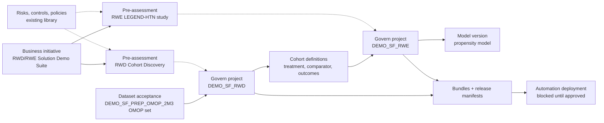

# RWD/RWE Suite — Governance MVP Proposal

Oct 22, 2026 · @Li-Heng Fu

> **Lifecycle:** Proposal (for review; folds into `project-scoping.md` as a new cross-cutting part when
> accepted) · **Part:** all · **Audience:** asset owners, suite owner, governance and QA leads, account
> team · **Authority:** proposed scope and design for governing the suite from design to deployment; not
> yet accepted · **Update when:** a decision below is taken, the access check changes, or the MVP scope moves.

## Why a governance layer

The revision already controls the suite like code: a registry, generated indexes, a schema gate, a
lineage check, a decision register and a CI `--check`. Those controls live in this repo. Nobody can see
them from the platform, nobody signs anything off, and the story stops at the design instance: deploying
the demo suite is out of scope, and every owner is still "to be named".

The proposal adds a fourth, cross-cutting part, **Governance by design**. It turns the gates the
migration plan already defines into Govern workflow steps with named sign-offs. It backs each sign-off
with evidence the index or DSS produces, and it carries the demo suite through packaging and a gated
deployment to the automation node. The demo it enables: one governance template, stamped across a
ten-project, three-part asset. Every dataset, cohort, study and release can be traced, has been checked,
and was approved by a named person before it ran in production.

It is a demonstration of GxP-ready patterns, not a validated system. SYNPUF is synthetic public-use
data, and under Dataiku's *Statement of Quality* (July 2026) validation and Part 11 compliance stay the
customer's responsibility. This suite plays the customer.

## Access check (2026-10-22)

| Surface | Result |
| --- | --- |
| `dku` profile `default` (Design) | Works: DSS 15.0.2, groups `designers`, `deployers`, `project_deployers`, `space_administrators`. **It is an int2 sandbox with 42 projects, not the suite's design instance**: none of the 16 suite projects is visible, while the 2026-10-16 snapshot saw 1,173 projects. `build_index.py --refresh` would read the wrong instance under this profile. |
| `dku` profile `govern` (Govern) | Works for reads: blueprints, fields, artifacts, sign-offs. `govern role list` and `blueprint get-version` fail with an authentication error: the key has no Govern admin rights, so blueprints, sign-off configs and roles cannot be authored with it. |
| Suite in Govern | No artifact for any suite project, dataset or bundle. |
| Skills | `dku-cli` with its Govern playbook (blueprints, artifacts, sign-offs, hooks, custom pages); Dataiku brand skills for any demo-facing page. |

The int2 Govern node already holds an Advanced Govern framework for Life Sciences, which the MVP
reuses rather than rebuilding:

| Blueprint | Artifacts | Use in the MVP |
| --- | --- | --- |
| `bp.policy_alignment` (Policy) | 102 | Link the suite to existing EU AI Act, NIST and ISO 42001 policies |
| `bp.control` (Control) | 81 | Library to pick the suite's controls from |
| `bp.risk` (Risk) | 77 | Library to pick the suite's risks from |
| `bp.pre_assessment` (Pre-Assessment, version `raft_ls_assessment`) | 16 | One per use case: intended use, PII, risk designation, human in the loop, sponsor |
| `bp.gmlp_dataset_governance` (Dataset Governance) | used | Dataset acceptance: `accepted_for_use`, `contains_pii`, source dataset |
| `bp.release_manifest` (Release Manifest) | 4 | Per-bundle evidence: datasets in flow, DQ summary, transformation chain |
| `bp.instruction_for_use`, `bp.asset_inventory` (revalidation history) | used | Post-MVP: propensity model IFU and revalidation |

Also on int2: 6 Project Standards checks, with a `LifeSciencesGovernance` scope that selects 4 projects
by key; one automation infrastructure (`automation_space-f44d872d-int2_node-f8b6893e`); and a deployed
`RWE_ANALYTICS` project governed end to end (pre-assessment, release manifest, approved sign-offs). That
project is the closest working reference for this MVP.

## Principles

1. **A sign-off is backed by evidence.** Every approval points to an index row, a DSS check result or a
   bundle the reviewer can open. Approving without evidence is not possible, because the step's required
   fields are the evidence.
2. **Reuse the framework, add only what the suite needs.** Fork versions of existing blueprints. The one
   new blueprint is the cohort definition, because a validated cohort is the unit this asset is sold on.
3. **Governance configuration is code.** Blueprint versions, sign-off configs and the role map are
   exported into this repo, reviewed like any change and imported to Govern. Imports land as DRAFT, and
   only role-based reviewers survive the round trip, so reviewers are always Govern roles.
4. **Scale through templates, not per-project setup.** A suite tag selects projects for Project
   Standards and for Govern. A new prep variant or a new study inherits the controls when it is
   registered.
5. **Writes to Govern follow the wiki rule.** A drift report is the default. Pushing records needs the
   owner's approval, as `push_wiki.py --push` does.

## Governed objects

| Govern object | Blueprint | One per | Filled from |
| --- | --- | --- | --- |
| Business initiative | `bp.system.business_initiative` | Suite | Hand-written, once |
| Pre-assessment | `bp.pre_assessment` | Use case (Part 2, Part 3) | `project-scoping.md`: personas, intended use, owners |
| Govern project | standard project sync | Active DSS project of the demo suite | DSS sync; the registry key links it |
| Dataset acceptance | `bp.gmlp_dataset_governance`, new version `bv.rwd_dataset` adding `data_licence` and `allowed_instances` | OMOP set of a prep project | `schema_compliance.tsv`, `datasets.tsv`, `lineage.tsv` |
| Cohort definition | **new** `bp.rwd_cohort_definition` | Governed cohort | `cohort_definition`, `cohort_building_log`, DQ results |
| Model version | standard model version sync | Propensity model version in `DEMO_SF_RWE` | DSS model evaluation |
| Bundle + release manifest | standard bundle sync + `bp.release_manifest` | Bundle of a demo-suite project | Bundle content, index, DQ results |

`bp.rwd_cohort_definition` fields: `cohort_definition_id`, `phenotype_source` (Atlas, hand-written),
`sql_sha256`, `governing_project`, `dialect_counts` (SF, DB, RS), `reference_count` and its date,
`dq_result`, `clinical_review_notes` and `used_by` (references to Govern projects). A change to the SQL
hash opens a new version of the record and resets the clinical sign-off.

**MVP cohort scope:** the solution's 3 sample cohorts and the cohorts `DEMO_SF_RWE` uses to define its
study population and outcomes (ACE-inhibitor first-line treatment, untreated comparator, and the
cardiovascular outcomes such as heart failure, stroke and AMI). They are listed exactly from
`cohort_definition` in D1. The 36 feature cohorts are recorded in the study's pre-assessment as one list
and are not reviewed one by one.

## Controls by domain

Every control states where DSS or Govern enforces it and which automated evidence proves it. Clause
references are to 21 CFR Part 11; the mapping is in the next section.

### Data access

| # | Control | Enforced in | Evidence |
| --- | --- | --- | --- |
| A1 | One DSS group per part (`rwd_data_foundation`, `rwd_solution`, `rwe_study`), plus `rwd_reviewers` (read and dashboards, no export). Write access only for the owning part's group | Project permissions | New `.index/access.tsv` from `dku project permissions`; new issue `ACCESS_UNEXPECTED` when a group is outside the registry's allow-list |
| A2 | SYNPUF stays on internal instances: no "Export datasets" permission on Part 1 projects outside `rwd_data_foundation`, and bundles that leave the instance carry no managed data | Project permissions; bundle content config | `access.tsv`; release manifest records the bundle's data content |
| A3 | Cross-project shares are the only data path, and every share is registered | Exposed objects | Existing `lineage.tsv`; new issue `SHARE_UNREGISTERED` |
| A4 | The demo Snowflake connection is usable only by the suite groups | Connection "allowed groups" (instance admin) | Connection settings, read into the snapshot |

### Lineage

| # | Control | Enforced in | Evidence |
| --- | --- | --- | --- |
| L1 | Zero broken shares and no dangling `data_preparation_project_key` in either variable scope | Existing index checks | `lineage.tsv`, `issues.tsv` (already gating CI) |
| L2 | Every RWE input traces back to an accepted dataset record through the solution import | Govern references: cohort → Govern project → dataset acceptance | New `.index/governance.tsv`; issue `UNGOVERNED` when an active project or one of its inputs has no record |
| L3 | Release manifest lists the datasets in flow and the transformation chain of the bundle | `bp.release_manifest` | Filled from the snapshot at bundle time |

### Data and cohort validation

| # | Control | Enforced in | Evidence |
| --- | --- | --- | --- |
| V1 | Schema contract: 15/15 v1.1 pass and built before anything downstream builds (DEC-RWD-003, gate B2) | DSS Data Quality rules on the 15 export tables (schema, non-empty, id unique); scenario stops on failure | `schema_compliance.tsv`; DQ results in the dataset record |
| V2 | The demo copy matches its canonical project (DEC-RWD-004, gate B4) | Row-count DQ rule against `PREP_RWD_S3_2M3` | `datasets.tsv` |
| V3 | Cohort reproducibility: the 3 sample cohorts give identical counts on SF, DB and RS (E4) | Release test scenario | `dialect_counts` field |
| V4 | Cohort regression: 2.3M counts match the recorded reference (for example heart failure 188,113, stroke 57,077, AMI 30,784 on 2025-10-06) | DQ rule on `cohort_building_log` | `reference_count` field |
| V5 | Cohort integrity: `subject_id` not null, `cohort_start_date <= cohort_end_date`, each episode inside an observation period, no duplicate episodes | DQ rules on `cohort` | `dq_result` field |
| V6 | Clinical plausibility: a clinical researcher reviews incidence, prevalence and demographics in the cohort dashboard | Govern sign-off on the cohort record | Sign-off with comments |

### Packaging

| # | Control | Enforced in | Evidence |
| --- | --- | --- | --- |
| P1 | Solution library pinned to a release tag of this repo; Project Setup manifest under version control (E1–E3) | Project Git references | `projects.tsv` library hash |
| P2 | One bundle per project per suite release, named after the release tag | Bundle export | Govern bundle record |
| P3 | Release manifest generated, not typed: datasets, DQ summary, library hash, schema result, cohort counts | `tools/push_govern.py` (new) | Release manifest record |
| P4 | Project Standards pass: description, flow zones, test scenario, column documentation | New `RWDSuite` Project Standards scope selected by tag `rwd-suite` | Compliance run attached to the release manifest |

### Deployment

| # | Control | Enforced in | Evidence |
| --- | --- | --- | --- |
| D1 | A bundle deploys only after its Govern sign-off is approved | Automation infrastructure's Govern check policy set to block unapproved bundles | Deployer refusal or acceptance; sign-off record |
| D2 | Deploy order follows the data: `DEMO_SF_PREP_OMOP_2M3` → `DEMO_SF_RWD` → `DEMO_SF_RWE` | Govern workflow step order (G5) | Deployment timestamps |
| D3 | Post-deploy smoke test: schema check, V4 cohort counts, RWE dashboard builds | Scenario on the automation node | Result pushed to the Govern project |
| D4 | Rollback: previous bundle kept and redeployable | Deployer | Deployment history |

## Workflow and sign-offs

The migration plan's gates become one suite release workflow. Each step needs the evidence fields above
to be filled before its sign-off opens.

| Step | Govern object | Feedback from | Approval by | Opens when |
| --- | --- | --- | --- | --- |
| G1 Data accepted | Dataset acceptance | QA / test engineer | Data foundation owner | V1, V2, A2 green |
| G2 Solution release validated | Govern project `SOL_RWD_COHORT_DISCOVERY` | QA / test engineer | Solution owner | P1, V3 green (E4) |
| G3 Cohorts validated | Cohort definition | Biomedical informaticist | Clinical researcher | V4, V5 green; G1 and G2 approved |
| G4 Study reviewed | Govern project `DEMO_SF_RWE` and its model version | Biostatistician | RWE demo owner | G3 approved; study rebuilt on the approved cohorts |
| G5 Release approved | Bundles of the three demo projects | Part owners | Suite owner | P2–P4 green; G1–G4 approved |

Govern roles map one to one onto the RACI in `project-scoping.md`, plus three reviewer roles (QA / test
engineer, clinical researcher, biostatistician). Each sign-off records the user, time and meaning (feedback
or approval) that 11.50 asks for.

## 21 CFR Part 11 mapping

Per the *Statement of Quality*, the customer's share of each clause is what the suite demonstrates.

| Clause | Platform capability (Statement of Quality) | Suite control | In the MVP |
| --- | --- | --- | --- |
| 11.10(a) Validation | Metrics, checks, scenarios; Govern workflows | V1–V5, schema gate, E4 cross-dialect test | Yes |
| 11.10(b) Copies of records | Exports, bundles, wiki, flow documentation | P2, P3; wiki standard | Yes |
| 11.10(c) Retention and retrieval | Bundles, Git history | Bundles kept internally; Govern records | Partly: retention period not set |
| 11.10(d) Access limited | Groups, SSO, UIF | A1, A4 | Yes, without UIF |
| 11.10(e) Audit trail | Audit trail, event server, Git | DSS and Govern timelines; repo history | Partly: event-server dispatch is an instance-admin task |
| 11.10(f) Sequencing | Govern workflows (Advanced Govern) | G1–G5; D1, D2 | Yes |
| 11.10(g) Authority checks | Per-project permissions, deployer rights | Role-gated sign-offs; deployer group | Yes |
| 11.10(h) Source validity | Connection permissions, schema, DQ, assertions | A4, V1, V5 | Yes |
| 11.10(i) Training | Academy, certification | — | No |
| 11.10(j) Written policies | Customer policies | Links to existing policy records | Reference only |
| 11.10(k) Documentation control | Wiki, Git, activity, metadata | Doc headers, decision register, wiki drift report, P4 | Yes |
| 11.50 Signature manifestation | Govern sign-off: user, time, meaning | G1–G5 | Yes. Govern is not an e-signature system; Subpart C is out of scope |

## Repo changes (governance as code)

| Change | What it adds |
| --- | --- |
| `govern/blueprints/` | Exported versions: `bp.rwd_cohort_definition`, `bp.gmlp_dataset_governance` `bv.rwd_dataset`, and the suite workflow's sign-off configs |
| `govern/roles.json` | Govern roles to DSS groups, mirroring the scoping RACI |
| `registry/projects.json` | Per project: `access_groups` (allow-list), `governed` (true for the demo suite), `govern_ref` once created |
| `tools/build_index.py` | `access.tsv` and `governance.tsv`; issue types `ACCESS_UNEXPECTED`, `SHARE_UNREGISTERED`, `UNGOVERNED`, `SIGNOFF_MISSING` (the last only for projects marked `governed`) |
| `tools/push_govern.py` | Drift report by default; `--push <PROJECT>` creates or updates Govern records from the index, with owner approval |
| `docs/` | This proposal; once accepted, a "Governance by design" section in `project-scoping.md` and a workstream F in the migration plan |

## Phasing

The MVP rides on the migration phases and does not block them. Nothing here writes to DSS or Govern
before the decisions below are taken.

| Step | With migration phase | Work | Exit gate |
| --- | --- | --- | --- |
| F0 Design | Now (phase 2) | Decide the open questions; draft blueprints and the role map in `govern/`; add `access.tsv` and `governance.tsv` read-only | Decisions recorded; index shows access and governance gaps as issues |
| F1 Data | Phase 3 | DQ rules on the export tables; dataset acceptance records; G1 | `DEMO_SF_PREP_OMOP_2M3` accepted in Govern |
| F2 Consumers | Phase 4 | Pre-assessments; cohort records; G2–G4 | Governed cohorts approved; study reviewed |
| F3 Release | After phase 4 | Bundles, release manifests, Project Standards scope, G5; deploy to automation with the Govern check on | Demo suite runs on the automation node from approved bundles; smoke test green |

**MVP done when:** the demo suite release walks G1–G5 in Govern with every sign-off linked to evidence;
the automation node refuses an unapproved bundle and accepts the approved one; and `build_index.py
--check` fails when a governed project has unexpected access, a missing record or a missing sign-off.

## Out of scope for the MVP

- Electronic-signature integration (Part 11 Subpart C), IQ/OQ/PQ and any claim of a validated system.
- User Isolation Framework, per-user database credentials, and audit-log dispatch to an external store.
  These are instance-administration changes; the proposal names them as the production path.
- Governing the `PREP_RWD_*` test variants and `SOL_RWD_COHORT_DISCOVERY`'s non-release builds in
  Govern. They stay governed by the index only.
- Model monitoring, drift and periodic revalidation (`bp.asset_inventory` revalidation history),
  training records (11.10(i)), and publishing to the Business Solutions Store.

## Decisions needed

- [ ] **Which instance and Govern node.** The suite lives on a design instance the current `dku`
  profiles cannot reach; the Govern framework lives on int2. Either connect the suite's design instance
  to a Govern node and import the forked blueprints there, or run the governed demo on int2. Both need
  confirmation that SYNPUF may sit there (internal-only rule).
- [ ] **Deployment back in scope.** The scoping doc excludes deploying the demo suite to the automation
  node for lack of authority. The MVP needs that authority, or it stops at G5 without D1–D4.
- [ ] **Named owners and reviewers.** Sign-offs need people: the four part owners plus the QA,
  clinical and biostatistics reviewers.
- [ ] **A Govern admin key** for blueprint, sign-off config and role work (the current key is read-only).
- [ ] **Cohort scope.** Confirm the governed cohorts: 3 sample cohorts plus the RWE study's population
  and outcome cohorts.

## Risks

| Risk | Mitigation |
| --- | --- |
| Index and Govern drift apart | Govern records are written only from the index (`push_govern.py`), and `governance.tsv` reports drift |
| Sign-off fatigue turns approvals into clicks | Five steps only; the 36 feature cohorts are not reviewed one by one; evidence fields are required |
| Forked blueprints affect other demos on the shared Govern node | New versions only, never `--force` on existing versions; other artifacts keep their version |
| The demo is read as a GxP validation claim | Banner on the Govern pages and wiki: synthetic data, customer-responsibility model, Subpart C out of scope |
| `--refresh` run under the int2 profile overwrites the snapshot with the wrong instance | Add an instance check to `build_index.py` that refuses a project count far below the last snapshot |
