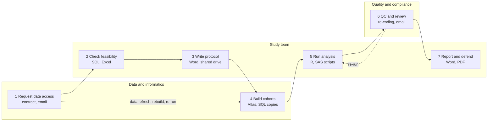
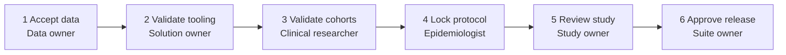
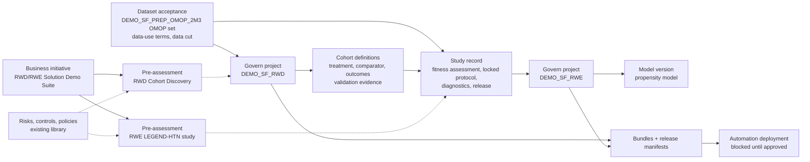

# RWD/RWE Suite — Governance MVP Proposal

Oct 22, 2026 · @Li-Heng Fu

> **Lifecycle:** Proposal (for review; folds into `project-scoping.md` as a new cross-cutting part when
> accepted) · **Part:** all · **Audience:** asset owners, suite owner, governance and QA leads, account
> team · **Authority:** proposed scope and design for governing the suite from data to deployment; not
> yet accepted · **Update when:** the MVP scope is agreed, a decision below is taken, or the migration
> closes.

*Revised 2026-11-13:* this is the text version of
[`governance-mvp-proposal.html`](governance-mvp-proposal.html) and follows the same order: market need,
opportunity, today's process, the process with the MVP, scope, stakeholders, then the technical
specification as an appendix. Two things changed in this revision. **The governance work now starts
after the migration closes** (phase 6 of `migration-revision-plan.md`); it no longer rides on the
migration phases. And a new section lists the changes the demo suite needs.

**What we need:** agreement on the MVP scope in section 5. User stories are written after that.
Evidence for sections 1 and 2 is in [`rwe-governance-review.md`](rwe-governance-review.md), which marks
how each claim was sourced.

## 1. The market need

Pharma companies no longer ask whether to use real-world evidence. They ask whether a regulator, a
payer or their own governance board will accept it. The answer depends less on the platform and more on
whether the study can show how it was run.

| | Figure | What it says | Source |
| --- | --- | --- | --- |
| Demand | 96% | of biopharma leaders call real-world data and evidence essential to strategy; 80% expect generative AI to change evidence generation within a year | Deloitte RWE benchmark, 2025 |
| Acceptance | 15% | of the real-world studies in 88 FDA approvals were judged inadequate, for design and data relevance: confounding, selection bias, misclassification, missing data | Purpura et al., 2022 |
| Reproducibility | 7% | of 250 published studies referenced their analysis code; nine expert teams given the same data and written methods built cohorts from 2,159 to 63,619 patients | Wang et al., 2022; Ostropolets et al., 2023 |

Three pressures are converging:

- **Regulators now ask for the same study record on both sides of the Atlantic.** ICH M14 has applied
  in the EU since March 2026 and is final at FDA. With FDA's RWE guidances and EMA's 2025 reflection
  paper, it asks for a protocol fixed before the outcome analysis, a data source shown fit for the
  question, validated definitions, and traceability from source data to result.
- **Access to data is becoming conditional on governance.** From March 2029 the European Health Data
  Space gives access through a data permit, for a stated purpose, inside a secure environment. In the
  US, data-owner agreements must already allow FDA to inspect the source.
- **AI raises the stakes.** Language models asked for clinical code lists returned about a third
  invented codes in one study. FDA and EMA published joint principles in January 2026 that ask for
  documented, human-checked use.

In surveys, the top barriers buyers name are data compatibility (29%), privacy and security (27%),
scarce talent that combines evidence and AI skills (25%) and regulatory uncertainty (23%). The last
three figures come from a trade-press summary of Deloitte's survey.

## 2. The opportunity

Audit trails, role-based access and security certificates are standard: every serious RWE platform
claims them. What we did not find in any vendor's public material is one record that joins the steps a
study goes through. This is an absence in public material, not proof that nobody does it.

| Market need | What exists today | What this MVP shows |
| --- | --- | --- |
| Prove the study was planned before it was run | Protocol locking inside purpose-built RWE tools; Word documents elsewhere | A protocol whose version is locked and time-stamped, and an analysis that refuses to run if the protocol changed |
| Show the data fits the question | Database-level quality checks; fitness judged informally | A fitness assessment recorded per study, required before the protocol can be locked |
| Trace a result to its data, definitions and code | Lineage within one tool; manual reconstruction across tools | Each result pinned to a data cut, vocabulary version, cohort definitions and code release |
| Use data only as permitted | Contracts held by legal; access granted by IT | Data-use terms on the dataset record, checked against each study's declared purpose |
| Keep approvals meaningful | Sign-off by email or committee slide | Six sign-offs, each opened only when its evidence exists |
| Survive a data refresh | Re-run by hand; changes found late | A refresh marks downstream approvals stale and triggers a compare |

**Why Dataiku.** The suite already runs across the customer's own data platforms (Snowflake,
Databricks, Redshift) on the OMOP standard, and Dataiku Govern provides workflows, sign-offs and
deployment gates. Purpose-built RWE tools govern inside their own product, and data science platforms
govern models. Governing a study across tools is the open position.

**How we describe it.** The suite demonstrates controls that support regulated work; the customer
validates its own system. Comparable platforms use the same wording. SYNPUF is synthetic public-use
data, and under Dataiku's *Statement of Quality* (July 2026) validation and Part 11 compliance stay the
customer's responsibility. This suite plays the customer.

## 3. The governance process today

Illustrative: a composite of a typical pharma RWE function as the published evidence portrays it, not
a named customer. Scenario: a comparative study of a first-line hypertension medicine, intended to
support a regulatory or payer decision.

| The cost | |
| --- | --- |
| Teams | 3 |
| Tools and file types | 6+ |
| Handoffs between teams | 5 |
| Rework loops | 2 |

Counts are read from this illustrative map, not measured at a customer.

**Nobody can show this today:**

- Was the data judged fit for this question before the study was designed?
- Was the protocol fixed before anyone saw the results?
- Which data cut, definitions and code produced this figure?
- Does the data licence allow this use?

**Decisions today.** Who: the study lead and a review committee. How: documents and email. When: once,
before the report. Trail: assembled by hand when someone asks.

## 4. The process with the MVP

The same study, run as one governed process on the demo suite. The platform checks and records; people
decide.

| Step | Who decides | Automated checks | Evidence record |
| --- | --- | --- | --- |
| 1 Accept data | Data owner | Schema, quality rules, data-use terms, version pins | Dataset: data cut, vocabulary, licence |
| 2 Validate tooling | Solution owner | Same cohort counts on three databases | Release: code version, test result |
| 3 Validate cohorts | Clinical researcher | Counts, integrity, composition, validation source | Cohort: definition fingerprint, reviewer notes |
| 4 Lock protocol | Epidemiologist | Fitness assessed; purpose permitted by the licence | Study: protocol fingerprint and lock time |
| 5 Review study | Study owner | Runs only on the locked protocol; balance diagnostics; attrition | Study: diagnostics, deviations log |
| 6 Approve release | Suite owner | An unapproved bundle cannot deploy | Manifest: what was deployed, from what |

**Target design, after the MVP:** phenotype validation runs, negative-control diagnostics, electronic
signature, secure-environment output checks for the EHDS, study registration, model revalidation.

**Now shown, for every study:**

- The data was accepted, with its permitted uses, before the study used it.
- The protocol was locked before the outcome analysis ran.
- Each figure traces to a data cut, definitions and code release.
- A data refresh reopens the approvals that depend on it.

Design targets for the MVP, not measured results: one record per study from data to result, six human
decisions, no unpinned result, one audit trail.

## 5. Proposed MVP scope

The MVP governs one study end to end on the demo suite (`DEMO_SF_PREP_OMOP_2M3` → `DEMO_SF_RWD` →
`DEMO_SF_RWE`). It is a demonstration on synthetic data, so two steps are shown as templates.

| Process step | Today | With the MVP | Status |
| --- | --- | --- | --- |
| Data access and permitted use | Contract and email; terms held outside the platform | Dataset accepted with licence, permitted purposes and version pins; each study's purpose checked against them | MVP |
| Fitness for the question | Ad hoc feasibility counts | Fitness assessment recorded per study, required before protocol lock | MVP, template |
| Protocol | Word document; version by file name | Protocol under version control, locked and time-stamped; analysis refuses to run if it changed | MVP |
| Cohort definitions | SQL copies; counts checked by eye | Fingerprinted definitions; count, integrity and composition checks; clinical sign-off against written criteria | MVP |
| Cohort validity | Rarely documented | Each cohort records how and where its definition was validated | MVP, template |
| Analysis and diagnostics | Scripts; QC by re-coding | Balance and equipoise judged against thresholds set in the protocol; attrition table on every run; deviations logged | MVP |
| Data refresh | Re-run by hand | New data cut or vocabulary marks approvals stale; re-run and compare before re-approval | MVP |
| Release and deployment | Report sent; trail rebuilt on request | Generated release manifest; deployment blocked until approved | MVP; needs deployment authority |
| Access control and lineage | Per tool | One group per part; registered data shares; index check fails on unexpected access | MVP |
| AI use | Unrecorded | Log of AI-assisted definitions or code, with the person who checked them | MVP |
| Negative-control diagnostics | Specialist practice | Strongest diagnostic in the literature; adds cohorts to the study | Decision |
| Phenotype validation runs, real fitness verdict | — | Not possible on synthetic data | Target |
| EHDS secure environment, study registration | — | Fields recorded now; behaviour later | Target |
| Electronic signature, system validation, training records | — | Customer responsibility | Out |

**The MVP is done when:**

- The demo study walks all six sign-offs in Govern, each linked to its evidence.
- The outcome analysis refuses to run when the protocol file is changed after lock.
- A changed data cut or vocabulary version marks the downstream approvals stale.
- The automation node refuses an unapproved release and accepts the approved one.
- The repository check fails on unexpected access, a missing record, an unpinned version or a missing
  sign-off.

## 6. Stakeholders

The suite plays the customer, so each role exists twice: as a persona the demo speaks to, and as a
named person who signs off in the MVP. No one is named yet.

| Stakeholder | What they need from governance | Role in the MVP process | Decides |
| --- | --- | --- | --- |
| Data owner / data steward (data office) | Data used only as licensed; one accepted version in use | Approves step 1 | Is this data accepted, and for which purposes |
| Biomedical informaticist (data and informatics) | Definitions that do not drift silently between versions | Feedback on step 3; owns cohort quality | — |
| Clinical researcher (medical) | Cohorts that mean what they claim clinically | Approves step 3 | Are these cohorts clinically plausible |
| Epidemiologist / HEOR researcher (study team) | A study design that will stand up to a regulator or payer | Approves step 4 | Is the data fit, and is the protocol final |
| Biostatistician (study team) | Diagnostics judged against thresholds set in advance | Feedback on steps 4 and 5 | — |
| Study owner (RWE lead) | Results that can be defended and repeated | Approves step 5 | Does the study stand as run |
| QA / test engineer (quality) | Evidence without rebuilding the trail by hand | Feedback on steps 1 and 2 | — |
| Solution owner (platform team) | One tested release of the tooling in use | Approves step 2 | Is this release fit to run studies |
| Suite owner (programme lead) | One view of what is approved and deployed | Approves step 6 | Does this release go live |
| Governance and compliance lead (regulatory, privacy, legal) | Policies visibly applied; data-use terms respected | Owns the policies and data-use terms the records link to | Sets the rules; no step sign-off in the MVP |
| Platform administrator (IT) | Changes that follow a controlled path | Sets up groups, connection access and the deployment gate | — |
| Regulator, HTA body, data provider (external) | An inspectable record; licensed use | Readers of the record; not users of the system | — |
| Account team (Dataiku) | A credible story for regulated customers | Presents the demo | — |

## 7. User stories

Written once the scope in section 5 is agreed, grouped by the stakeholder who acts:

- **Data owner:** accept a dataset and state its permitted uses.
- **Clinical researcher and informaticist:** review and approve a cohort; see what changed since the
  last approval.
- **Epidemiologist and biostatistician:** record data fitness; lock a protocol; review diagnostics.
- **Study owner and suite owner:** approve a study and a release; see what is stale after a refresh.
- **QA and compliance:** retrieve the full record for one result.

## 8. Sequencing: after the migration

The governance work waits for the migration to close. At that point the three demo projects exist in
their final form, read only from each other, and run a tagged library, so sign-offs are given on a
stable suite and not on projects about to be recreated.

| Step | Starts when | Work | Exit gate |
| --- | --- | --- | --- |
| F0 Design | Scope agreed; needs no DSS change, so it can be drafted at any time | Decisions; user stories; blueprints and role map in `govern/`; protocol and fitness template in `studies/`; read-only `access.tsv` and `governance.tsv` | Decisions recorded; index shows access and governance gaps as issues |
| F1 Data | Migration phase 6 closed | Data Quality rules on the export tables; dataset acceptance with terms and pins; G1 | `DEMO_SF_PREP_OMOP_2M3` accepted in Govern |
| F2 Cohorts | F1 | Pre-assessments; cohort records, fingerprints, composition check; G2, G3 | Governed cohorts approved |
| F3 Study | F2 | Study record; protocol lock (G4); scenario, diagnostics and attrition steps in `DEMO_SF_RWE`; governed rebuild; G5 | Protocol locked before the rebuild's outcome analysis; study reviewed |
| F4 Release | F3 | Bundles, release manifests, Project Standards scope, G6; gated deployment | Suite runs on the automation node from approved bundles; smoke test green |

Every step from F1 changes DSS projects or writes to Govern, and each needs the project owner's
approval as it starts.

**What the migration should leave behind.** No new migration work, only records that are cheap to keep
now and hard to recover later:

- The data cut and source of `DEMO_SF_PREP_OMOP_2M3` when it is created, and the OMOP vocabulary
  version if the source carries it. The 15 export tables do not include the `vocabulary` or
  `cdm_source` tables where that version normally lives; whether the source has them is not checked.
- The cohort counts `DEMO_DB_RWD2` recorded on 2025-10-06, exported before it is retired (already D1
  step 6). They become the reference for the cohort regression check.
- The E4 result: the three sample cohorts' counts on Snowflake, Databricks and Redshift. It is the
  evidence for sign-off 2.
- The notebook baseline of the Cox results that D2 step 7 compares against. It becomes the study's
  first reference result.

## 9. Changes to the demo suite

Read from the index snapshot of 2026-11-05 and the migration plan; live DSS was not checked. Today
`DEMO_SF_PREP_OMOP_2M3` is planned and not on DSS, `DEMO_SF_RWD` is on an old library branch with broken
mappings, `DEMO_SF_RWE` still reads from the retiring `DEMO_DB_RWD2` and has no scenario, and every
project's owner is unassigned.

| Project | Done by the migration | New for the framework |
| --- | --- | --- |
| `DEMO_SF_PREP_OMOP_2M3` | Created as a sync-only variant of `PREP_RWD_S3_2M3`; 15/15 schema pass; row counts match | Data Quality rules on the 15 tables with a scenario that stops on failure; recorded data cut, vocabulary version and ETL version; data-use terms in the registry |
| `DEMO_SF_RWD` | Recreated from the released solution; 45 cohorts rebuilt; counts checked against the reference | Integrity rules on `cohort`; a composition check (age, sex, index year) against a stored reference; a fingerprint per governed cohort definition; validation source and expected ranges per governed cohort |
| `DEMO_SF_RWE` | 9 inputs repointed to `DEMO_SF_RWD`; notebook replaced by a Cox recipe and static report | Protocol and fitness files in the repo; a scenario that runs the study end to end and stops if the protocol is not locked; a balance and overlap diagnostics step between the propensity model and the Cox model; an attrition table; a deviations log |
| All three | Library pinned to the release tag at the phase 6 merge | Suite groups and export permissions; the `rwd-suite` tag and Project Standards; one bundle per release; Govern sync; the deployment gate |

Points that need care:

- **`DEMO_SF_RWE` is the largest piece.** It needs a new scenario and two or three new recipes. The
  study weights by inverse probability, so balance is checked on the weighted population.
- **Cohort fingerprints.** Atlas SQL embeds its concept sets, so one hash of the SQL may be enough for
  the MVP. A separate concept-set hash means resolving the sets against the vocabulary.
- **Repo and Govern work is separate from the projects:** registry fields, two new index files and
  issue types, `tools/push_govern.py`, the blueprints and the role map.

## 10. Decisions needed

To agree the scope:

- [ ] **Study as a governed record.** Accept a study record alongside the cohort record.
- [ ] **Negative controls.** In or out of the MVP. They add outcome cohorts to `DEMO_SF_RWD` and a
  calibration step to `DEMO_SF_RWE`.
- [ ] **Deployment.** The scoping document excludes deploying the demo suite for lack of authority.
  Without it the MVP stops before the deployment gate.
- [ ] **Cohorts in scope.** The 3 sample cohorts plus the study's population and outcome cohorts; the
  36 feature cohorts listed but not reviewed one by one.

To start building, after the migration:

- [ ] **Named owners and reviewers** for the six sign-offs.
- [ ] **Instance and Govern node.** The suite's design instance is not the one the Govern framework
  sits on. Either choice needs confirmation that SYNPUF may sit there.
- [ ] **A Govern admin key.** The current key is read-only.
- [ ] **Protocol author and thresholds** for the demo study (the usual balance threshold is a
  standardised mean difference below 0.1).
- [ ] **Data-use terms for SYNPUF**, so the purpose check has real values.
- [ ] **Blueprint form.** A separate `bp.rwe_study`, or the study fields on a new version of
  `bp.pre_assessment`. The proposal prefers a separate blueprint: the pre-assessment is filled once,
  the study record changes with every protocol version and data cut.

## 11. Risks

| Risk | Mitigation |
| --- | --- |
| The MVP grows into a study-methods project | Study controls are records, fingerprints and two automated steps; validation runs and EHDS behaviour stay out |
| Sign-offs turn into clicks | Six steps only; evidence fields are required; clinical review has written criteria |
| Template records on synthetic data are read as real evidence | Banner on the records; fields say "template" |
| The demo is read as a validation claim | "Supports the controls; the customer validates" on every page; Subpart C out of scope |
| The migration slips and the governance work slips with it | F0 needs no DSS change and can be drafted meanwhile; the records listed in section 8 are kept as the migration runs |
| Regulatory references age | The review is dated and lists drafts and pending acts |

---

## Appendix — Technical specification

For the builders. G1–G6 are the six process steps of section 4.

### A. Principles

1. **Govern the study, not only the platform.** Each platform control is tied to the study record it
   protects.
2. **A sign-off is backed by evidence.** The step's required fields are the evidence: an index row, a
   DSS check result, a file hash or a bundle.
3. **The executable specification is the record.** Protocol, cohort definitions and code, pinned to a
   data cut and a vocabulary version.
4. **Reuse the framework, add only what the suite needs.** Fork versions of existing blueprints. Two
   blueprints are new: the cohort definition and the study.
5. **Governance configuration is code.** Blueprint versions, sign-off configs and the role map are
   exported into this repo and imported to Govern as DRAFT. Only role-based reviewers survive the round
   trip, so reviewers are always Govern roles.
6. **Scale through templates, not per-project setup.** A suite tag selects projects for Project
   Standards and for Govern.
7. **Writes to Govern follow the wiki rule.** A drift report is the default; pushing records needs the
   owner's approval, as `push_wiki.py --push` does.

### B. Governed objects

| Govern object | Blueprint | One per | Filled from |
| --- | --- | --- | --- |
| Business initiative | `bp.system.business_initiative` | Suite | Hand-written, once |
| Pre-assessment | `bp.pre_assessment` | Use case (Part 2, Part 3) | `project-scoping.md`: personas, intended use, owners |
| Govern project | standard project sync | Active DSS project of the demo suite | DSS sync; the registry key links it |
| Dataset acceptance | `bp.gmlp_dataset_governance`, new version `bv.rwd_dataset` | OMOP set of a prep project, per data cut | `schema_compliance.tsv`, `datasets.tsv`, `lineage.tsv`, registry |
| Cohort definition | **new** `bp.rwd_cohort_definition` | Governed cohort | `cohort_definition`, `cohort_building_log`, DQ results |
| Study | **new** `bp.rwe_study` | Study (`DEMO_SF_RWE`: the LEGEND-HTN replication) | `studies/<key>/` in this repo; DSS diagnostics |
| Model version | standard model version sync | Propensity model version in `DEMO_SF_RWE` | DSS model evaluation |
| Bundle + release manifest | standard bundle sync + `bp.release_manifest` | Bundle of a demo-suite project | Bundle content, index, DQ results |

**`bv.rwd_dataset`** adds to the dataset record:

- Data-use terms: `data_licence`, `allowed_instances`, `permitted_purposes`, `patient_level_export`.
- Version pins: `data_cut_id`, `cdm_version`, `vocabulary_version`, `etl_version` (the prep project's
  library hash).

A new data cut or vocabulary version opens a new version of the record.

**`bp.rwd_cohort_definition`** fields:

- Identity: `cohort_definition_id`, `phenotype_source` (Atlas, OHDSI Phenotype Library, hand-written),
  `sql_sha256`, `concept_set_sha256`, `vocabulary_version`, `governing_project`.
- Reproducibility: `dialect_counts` (SF, DB, RS), `reference_count` and its date, `dq_result`.
- Validity: `validation_method` (published validation, chart review, PheValuator, none),
  `validation_source` and its metrics where they exist, `characterisation` (age, sex and index-year
  distribution at the reference date).
- Review: `clinical_review_notes`, `ai_assisted` (with the reviewer who validated it), `used_by`.

A change to the SQL hash, the concept-set hash or the vocabulary version opens a new version of the
record and resets the clinical sign-off.

**`bp.rwe_study`** follows the stages of ICH M14 and the HARPER protocol template:

| Stage | Fields |
| --- | --- |
| Question | `research_question`, `declared_purpose`, `intended_use` (demo, internal decision, regulatory) |
| Data fitness | `dataset_refs`; `fitness_assessment`: for exposure, each outcome and the key confounders, whether the data captures it, with follow-up and sample size; `fitness_verdict` |
| Protocol | `protocol_path`, `protocol_sha256`, `locked_at`; `cohort_refs` with their SQL hashes; `target_trial_spec`; `diagnostic_thresholds`; `planned_sensitivity_analyses` |
| Conduct | `code_ref` (repo tag), `data_cut_id`, `attrition_table`, `diagnostics_result`, `deviations_log`, `exploratory_analyses` |
| Release | `results_ref`, `registration` (the HMA-EMA Catalogue fields, recorded, not submitted), `ai_use_log` |

**MVP cohort scope:** the solution's 3 sample cohorts and the cohorts `DEMO_SF_RWE` uses to define its
study population and outcomes (ACE-inhibitor first-line treatment, untreated comparator, and the
cardiovascular outcomes such as heart failure, stroke and AMI), listed exactly from `cohort_definition`
in the recreated `DEMO_SF_RWD`. The 36 feature cohorts are recorded in the study record as one list.

**What synthetic data limits.** `validation_source` cites the published definition each cohort comes
from, and the fitness assessment is filled as a worked template. Both carry the synthetic-data banner.
The protocol for `DEMO_SF_RWE` is written from the published LEGEND-HTN protocol; the lock is
demonstrated on a governed rebuild of the study after the migration (F3), not on the study's first run.

### C. Controls by domain

Every control states where DSS or Govern enforces it and which automated evidence proves it.

**Data access and use**

| # | Control | Enforced in | Evidence |
| --- | --- | --- | --- |
| A1 | One DSS group per part (`rwd_data_foundation`, `rwd_solution`, `rwe_study`), plus `rwd_reviewers` (read and dashboards, no export). Write access only for the owning part's group | Project permissions | New `.index/access.tsv` from `dku project permissions`; new issue `ACCESS_UNEXPECTED` |
| A2 | SYNPUF stays on internal instances: no "Export datasets" permission on Part 1 projects outside `rwd_data_foundation`, and bundles that leave the instance carry no managed data | Project permissions; bundle content config | `access.tsv`; release manifest |
| A3 | Cross-project shares are the only data path, and every share is registered | Exposed objects | Existing `lineage.tsv`; new issue `SHARE_UNREGISTERED` |
| A4 | The demo Snowflake connection is usable only by the suite groups | Connection "allowed groups" (instance admin) | Connection settings, read into the snapshot |
| A5 | A study uses a dataset only for a purpose its data-use terms permit | Study `declared_purpose` must be in every referenced dataset's `permitted_purposes` | `governance.tsv`; new issue `PURPOSE_NOT_PERMITTED` |

**Lineage and traceability**

| # | Control | Enforced in | Evidence |
| --- | --- | --- | --- |
| L1 | Zero broken shares and no dangling `data_preparation_project_key` in either variable scope | Existing index checks | `lineage.tsv`, `issues.tsv` (already gating CI) |
| L2 | Every study input traces back to an accepted dataset record | Govern references: study → cohort → Govern project → dataset acceptance | New `.index/governance.tsv`; issue `UNGOVERNED` |
| L3 | Release manifest lists the datasets in flow and the transformation chain of the bundle | `bp.release_manifest` | Filled from the snapshot at bundle time |
| L4 | Every result is pinned to a data cut, CDM version, vocabulary version, ETL version, cohort hashes and code tag | Dataset, cohort and study records | `governance.tsv`; issue `VERSION_UNPINNED` |

**Data and cohort validation**

| # | Control | Enforced in | Evidence |
| --- | --- | --- | --- |
| V1 | Schema contract: 15/15 v1.1 pass and built before anything downstream builds (DEC-RWD-003) | DSS Data Quality rules on the 15 export tables (schema, non-empty, id unique); scenario stops on failure | `schema_compliance.tsv`; DQ results |
| V2 | The demo variant matches its canonical project (DEC-RWD-006) | Row-count DQ rule against `PREP_RWD_S3_2M3` | `datasets.tsv` |
| V3 | Cohort reproducibility: the 3 sample cohorts give identical counts on SF, DB and RS | Release test scenario; the migration's E4 result is the first evidence | `dialect_counts` |
| V4 | Cohort regression: 2.3M counts match the recorded reference (for example heart failure 188,113, stroke 57,077, AMI 30,784 on 2025-10-06) | DQ rule on `cohort_building_log` | `reference_count` |
| V5 | Cohort integrity: `subject_id` not null, `cohort_start_date <= cohort_end_date`, each episode inside an observation period, no duplicate episodes | DQ rules on `cohort` | `dq_result` |
| V6 | Cohort composition: age, sex and index-year distribution compared with the recorded reference | Scenario step on the cohort dashboard's datasets | `characterisation` and its diff |
| V7 | Cohort validity: each governed cohort records how its definition was validated and on which source; "none" is allowed but visible | Required fields on the cohort record | `validation_method`, `validation_source` |
| V8 | Clinical plausibility: reviewed against expected ranges written in the record before review | Govern sign-off on the cohort record | Sign-off with comments |

**Study design and conduct**

| # | Control | Enforced in | Evidence |
| --- | --- | --- | --- |
| S1 | Fit-for-purpose assessment completed before the protocol is locked | Required fields on the study record | `fitness_assessment`, `fitness_verdict` |
| S2 | Protocol and analysis plan in the repo, in HARPER structure, with the target-trial table; hash and time recorded at lock | `studies/<key>/protocol.md`; study record | `protocol_sha256`, `locked_at`; issue `PROTOCOL_CHANGED` |
| S3 | The outcome analysis runs only on a locked protocol | Scenario step in `DEMO_SF_RWE` reads the study record and stops if the protocol is not locked or its hash differs | Scenario run; study sign-off |
| S4 | Design diagnostics judged against thresholds written in the protocol: standardised mean difference per covariate on the weighted population, equipoise | Scenario step after the propensity model, before the outcome model; stops on failure | `diagnostics_result` |
| S5 | Attrition table generated on every run | Recipe output in `DEMO_SF_RWE` | `attrition_table` |
| S6 | A protocol change after lock is a new version with a reason; analyses outside the plan are listed as exploratory | Study record versions | `deviations_log`, `exploratory_analyses` |
| S7 | AI-generated concept sets or code name their reviewer | Cohort and study records | `ai_assisted`, `ai_use_log` |

**Change control**

| # | Control | Enforced in | Evidence |
| --- | --- | --- | --- |
| C1 | A new data cut, vocabulary version or ETL version reopens the dataset acceptance and the sign-offs downstream of it | New record version resets sign-offs on dependent cohort and study records | Record versions; issue `SIGNOFF_STALE` |
| C2 | After a refresh, cohorts and study are re-run and compared with the previous cut before re-approval | Refresh scenario: V4, V6 and the study results diff | Diff attached to the dataset record |

**Packaging**

| # | Control | Enforced in | Evidence |
| --- | --- | --- | --- |
| P1 | Solution library pinned to a release tag of this repo; Project Setup manifest under version control | Project Git references | `projects.tsv` library hash |
| P2 | One bundle per project per suite release, named after the release tag | Bundle export | Govern bundle record |
| P3 | Release manifest generated, not typed: datasets, DQ summary, library hash, schema result, cohort counts, protocol hash, diagnostics result | `tools/push_govern.py` (new) | Release manifest record |
| P4 | Project Standards pass: description, flow zones, test scenario, column documentation | New `RWDSuite` Project Standards scope selected by tag `rwd-suite` | Compliance run attached to the release manifest |

**Deployment**

| # | Control | Enforced in | Evidence |
| --- | --- | --- | --- |
| D1 | A bundle deploys only after its Govern sign-off is approved | Automation infrastructure's Govern check policy set to block unapproved bundles | Deployer refusal or acceptance; sign-off record |
| D2 | Deploy order follows the data: `DEMO_SF_PREP_OMOP_2M3` → `DEMO_SF_RWD` → `DEMO_SF_RWE` | Govern workflow step order (G6) | Deployment timestamps |
| D3 | Post-deploy smoke test: schema check, V4 cohort counts, S4 diagnostics, RWE dashboard builds | Scenario on the automation node | Result pushed to the Govern project |
| D4 | Rollback: previous bundle kept and redeployable | Deployer | Deployment history |

### D. Workflow and sign-offs

| Step | Govern object | Feedback from | Approval by | Opens when |
| --- | --- | --- | --- | --- |
| G1 Data accepted | Dataset acceptance | QA / test engineer | Data foundation owner | V1, V2, A2 green; data-use terms and version pins filled |
| G2 Solution release validated | Govern project `SOL_RWD_COHORT_DISCOVERY` | QA / test engineer | Solution owner | P1, V3 green |
| G3 Cohorts validated | Cohort definition | Biomedical informaticist | Clinical researcher | V4–V7 green; G1 and G2 approved |
| G4 Protocol locked | Study | Biostatistician | Epidemiologist / HEOR researcher | S1, S2, A5 green; G3 approved for every cohort the protocol names |
| G5 Study reviewed | Study, Govern project `DEMO_SF_RWE` and its model version | Biostatistician | RWE demo owner | G4 approved; study rebuilt on the approved cohorts; S3–S6 green |
| G6 Release approved | Bundles of the three demo projects | Part owners | Suite owner | P2–P4 green; G1–G5 approved |

Govern roles map one to one onto the RACI in `project-scoping.md`, plus four reviewer roles (QA / test
engineer, clinical researcher, biostatistician, epidemiologist). Each sign-off records the user, time
and meaning (feedback or approval).

### E. Regulatory mapping

The study layer answers the RWE-specific expectations in the US and the EU. The system layer answers
21 CFR Part 11, which FDA's 2023 guidance applies to the sponsor's systems, not to the source of the
data. Sources, status and dates are in [`rwe-governance-review.md`](rwe-governance-review.md).

**Study layer: US and EU**

| Expectation | US | EU | Suite control | In the MVP |
| --- | --- | --- | --- | --- |
| Protocol and analysis plan fixed before the outcome analysis; amendments dated; other analyses labelled exploratory | FDA *Considerations* (2023); ICH M14 | ICH M14; EMA reflection paper (2025); HTA guidance | S2, S3, S6; G4 | Yes, on the governed rebuild |
| Data source fit for the question | FDA *EHR and Claims* (2024); ICH M14 | ICH M14; Data Quality Framework | S1 | Template only: synthetic data |
| Operational definitions in the protocol, validated, re-checked on a new source or period | FDA *EHR and Claims* (2024) | ICH M14 | V7, V8; C1 | Partly: published validation cited, none run |
| Traceability from source data to result; transformations documented | FDA *Considerations*; *EHR and Claims* | EMA reflection paper | L1–L4; P3 | Yes |
| QA/QC plan with reproducible steps | FDA *EHR and Claims* | Data Quality Framework | V1–V6; C2 | Yes |
| Bias and confounding addressed; diagnostics reported | ICH M14 | ICH M14; EMA reflection paper | S4, S5 | Partly: balance and equipoise; no negative controls |
| Data-owner agreement, permitted use, access to source for inspection | FDA *Considerations* | GDPR Art. 89; EHDS permits (from 2029) | A2, A5; `bv.rwd_dataset` | Yes for terms; inspection access not shown |
| Patient-level data deliverable to the regulator | FDA *Considerations* (under review, RFI Nov 2026) | — | `patient_level_export` | Recorded only |
| Study registration and results made public | — | HMA-EMA Catalogues; EHDS | `registration` | Recorded, not submitted |
| Processing inside a secure environment, named users, no person-level export | — | EHDS (from 2029) | A1, A2 | Partly: no output checking |
| AI use documented by context of use | FDA draft (2025); FDA-EMA principles (2026) | FDA-EMA principles; AI Act research exemption | S7; pre-assessment | Yes, as a log |

**System layer: 21 CFR Part 11**

Per the *Statement of Quality*, the customer's share of each clause is what the suite demonstrates.

| Clause | Platform capability (Statement of Quality) | Suite control | In the MVP |
| --- | --- | --- | --- |
| 11.10(a) Validation | Metrics, checks, scenarios; Govern workflows | V1–V6, schema gate, cross-dialect test | Yes |
| 11.10(b) Copies of records | Exports, bundles, wiki, flow documentation | P2, P3; wiki standard | Yes |
| 11.10(c) Retention and retrieval | Bundles, Git history | Bundles kept internally; Govern records | Partly: retention period not set |
| 11.10(d) Access limited | Groups, SSO, UIF | A1, A4 | Yes, without UIF |
| 11.10(e) Audit trail | Audit trail, event server, Git | DSS and Govern timelines; repo history | Partly: event-server dispatch is an instance-admin task |
| 11.10(f) Sequencing | Govern workflows (Advanced Govern) | G1–G6; S3; D1, D2 | Yes |
| 11.10(g) Authority checks | Per-project permissions, deployer rights | Role-gated sign-offs; deployer group | Yes |
| 11.10(h) Source validity | Connection permissions, schema, DQ, assertions | A4, V1, V5 | Yes |
| 11.10(i) Training | Academy, certification | — | No |
| 11.10(j) Written policies | Customer policies | Links to existing policy records | Reference only |
| 11.10(k) Documentation control | Wiki, Git, activity, metadata | Doc headers, decision register, wiki drift report, P4 | Yes |
| 11.50 Signature manifestation | Govern sign-off: user, time, meaning | G1–G6 | Yes. Govern is not an e-signature system; Subpart C is out of scope |

### F. Repo changes (governance as code)

| Change | What it adds |
| --- | --- |
| `govern/blueprints/` | Exported versions: `bp.rwd_cohort_definition`, `bp.rwe_study`, `bp.gmlp_dataset_governance` `bv.rwd_dataset`, and the suite workflow's sign-off configs |
| `govern/roles.json` | Govern roles to DSS groups, mirroring the scoping RACI |
| `studies/DEMO_SF_RWE/` | `protocol.md` (HARPER structure, target-trial table, diagnostic thresholds, planned sensitivity analyses) and `fitness.md`; their hashes go into the study record |
| `registry/projects.json` | Per project: `access_groups`, `governed`, `govern_ref`. Per OMOP set: `data_licence`, `permitted_purposes`, `data_cut_id`, `vocabulary_version` |
| `tools/build_index.py` | `access.tsv` and `governance.tsv`; issue types `ACCESS_UNEXPECTED`, `SHARE_UNREGISTERED`, `UNGOVERNED`, `VERSION_UNPINNED`, `PURPOSE_NOT_PERMITTED`, `PROTOCOL_CHANGED`, `SIGNOFF_STALE`, `SIGNOFF_MISSING` (the last four only for projects marked `governed`) |
| `tools/push_govern.py` | Drift report by default; `--push <PROJECT>` creates or updates Govern records from the index, with owner approval |
| `docs/` | This proposal and the review; once accepted, a "Governance by design" section in `project-scoping.md` and a workstream F in the migration plan |

### G. Access check (2026-10-22, not repeated since)

| Surface | Result |
| --- | --- |
| `dku` profile `default` (Design) | Works: DSS 15.0.2, groups `designers`, `deployers`, `project_deployers`, `space_administrators`. **It is an int2 sandbox with 42 projects, not the suite's design instance**: none of the 16 suite projects is visible, while the 2026-10-16 snapshot saw 1,173 projects. `build_index.py --refresh` would read the wrong instance under this profile. |
| `dku` profile `govern` (Govern) | Works for reads: blueprints, fields, artifacts, sign-offs. `govern role list` and `blueprint get-version` fail with an authentication error: the key has no Govern admin rights. |
| Suite in Govern | No artifact for any suite project, dataset or bundle. |
| Skills | `dku-cli` with its Govern playbook; Dataiku brand skills for any demo-facing page. |

The int2 Govern node already holds an Advanced Govern framework for Life Sciences, which the MVP
reuses:

| Blueprint | Artifacts | Use in the MVP |
| --- | --- | --- |
| `bp.policy_alignment` (Policy) | 102 | Link the suite to existing EU AI Act, NIST and ISO 42001 policies |
| `bp.control` (Control) | 81 | Library to pick the suite's controls from |
| `bp.risk` (Risk) | 77 | Library to pick the suite's risks from |
| `bp.pre_assessment` (Pre-Assessment, version `raft_ls_assessment`) | 16 | One per use case: intended use, PII, risk designation, human in the loop, sponsor |
| `bp.gmlp_dataset_governance` (Dataset Governance) | used | Dataset acceptance: `accepted_for_use`, `contains_pii`, source dataset |
| `bp.release_manifest` (Release Manifest) | 4 | Per-bundle evidence: datasets in flow, DQ summary, transformation chain |
| `bp.instruction_for_use`, `bp.asset_inventory` (revalidation history) | used | Post-MVP: propensity model IFU and revalidation |

Also on int2: 6 Project Standards checks, with a `LifeSciencesGovernance` scope that selects 4 projects
by key; one automation infrastructure (`automation_space-f44d872d-int2_node-f8b6893e`); and a deployed
`RWE_ANALYTICS` project governed end to end, the closest working reference for this MVP.

### H. Out of scope and technical risks

- Electronic-signature integration (Part 11 Subpart C), IQ/OQ/PQ and any claim of a validated system.
- User Isolation Framework, per-user database credentials, and audit-log dispatch to an external store.
  These are instance-administration changes; the proposal names them as the production path.
- Running a phenotype validation (chart review or PheValuator) and a real fitness verdict.
- Negative-control outcomes and empirical calibration, unless the decision brings them in.
- EHDS secure-environment behaviour and actual registration in the HMA-EMA Catalogues.
- Packaging patient-level data for a regulatory submission.
- Governing the `PREP_RWD_*` test variants and `SOL_RWD_COHORT_DISCOVERY`'s non-release builds in
  Govern. They stay governed by the index only.
- Model monitoring, drift and periodic revalidation, training records (11.10(i)), and publishing to the
  Business Solutions Store.

| Technical risk | Mitigation |
| --- | --- |
| Index and Govern drift apart | Govern records are written only from the index (`push_govern.py`), and `governance.tsv` reports drift |
| The protocol lock is read as retrospective | Stated in the record: the protocol follows a published one, and the lock precedes the governed rebuild's outcome analysis |
| Forked blueprints affect other demos on the shared Govern node | New versions only, never `--force` on existing versions |
| `--refresh` run under the int2 profile overwrites the snapshot with the wrong instance | Add an instance check to `build_index.py` that refuses a project count far below the last snapshot |
