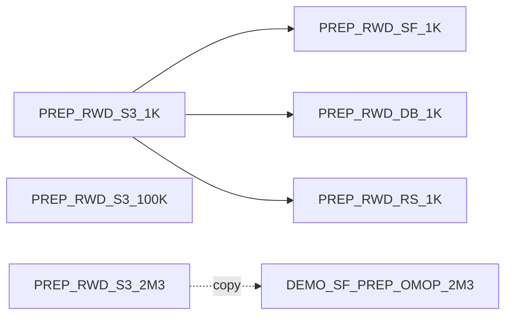

# RWD Cohort Discovery — Migration & Revision Plan

Sep 23, 2026 · @Li-Heng Fu

> **Lifecycle:** Planning (active until phase 5 closes) · **Part:** all · **Audience:** asset owners and
> contributors executing the migration · **Authority:** per-project decisions, step order and gates ·
> **Update when:** a step completes, a gate changes or an open question is decided. Live state is in
> `.index/`, not here.

## Summary and target end state

The suite goes from 11 in-scope projects to 10. Three S3 canonical projects, three sync-only database variants and one full copy for the demo suite replace seven prep projects, and `DEMO_DB_RWD2` is retired once `DEMO_SF_RWE` no longer depends on it. The solution is revised first (Workstream E), its code moves into this repo, and it is tested against every SQL `PREP_RWD_*` project. The demo suite is `DEMO_SF_PREP_OMOP_2M3` → `DEMO_SF_RWD` → `DEMO_SF_RWE`. Publishing it to the automation node is out of scope for now: it needs someone with authority to deploy to that instance.

*Revised 2026-10-16:* the 2.3M Snowflake set is renamed `DEMO_SF_PREP_OMOP_2M3` and is a full copy of `PREP_RWD_S3_2M3`, the one exception to DEC-RWD-002 ([DEC-RWD-004](decisions/DECISION_REGISTER.md#dec-rwd-004--the-demo-suites-23m-prep-project-is-a-full-copy-of-prep_rwd_s3_2m3)); the `PREP_RWD_*` database variants stay sync-only; `DEMO_SF_RWD` is recreated from the revised solution; Workstream D waits for Workstream E.

New prep project keys use the pattern `PREP_RWD_<storage>_<size>`. Projects of the demo suite start with `DEMO_SF_`.

| Current project | Decision | Target | Why |
| --- | --- | --- | --- |
| `SYNPUFOMOP1KDATAPREPRWDV11` | Rebuild | `PREP_RWD_S3_1K` + `PREP_RWD_SF_1K`, `PREP_RWD_DB_1K`, `PREP_RWD_RS_1K` | Reference workflow; all 15 tables pass on S3, RS and DB, but its Snowflake tables are unbuilt |
| `RWD1KDATAPREPDEMO` | Retire after rebuild | — | Same 1K data, S3 only; superseded by `PREP_RWD_S3_1K` |
| `SYNPUFOMOP1KREDSHIFTDATAPREPARATION` | Retire | — | Ancestor of the RWDV11 project; superseded by `PREP_RWD_RS_1K` |
| `SYNPUFOMOP100KDATAPREPARATION` | Rebuild | `PREP_RWD_S3_100K` | Its Snowflake set passes but is unbuilt; its Redshift set is incomplete |
| `SYNPUFOMOP23DATAPREPARATION` | Rebuild | `PREP_RWD_S3_2M3` | Reference 2.3M download workflow; exports use the legacy `date` type |
| `DATABRICKSSYNPUFOMOP23DATAPREPERATION` | Retire | — | Legacy `date` type on 13 of 15 tables; no Databricks variant is needed at 2.3M |
| `DEMO_SF_OMOP2M_DATAPREP` | Replace | `DEMO_SF_PREP_OMOP_2M3` | Legacy `date` type on 13 of 15 mapped tables; its tables are unbuilt |
| `SOL_RWD_COHORT_DISCOVERY` | Revise, repoint | Library from this repo; setup errors fixed; tested on every SQL `PREP_RWD_*`; reads `PREP_RWD_SF_1K` | Release reference |
| `DEMO_SF_RWD` | Recreate from the revised solution | Copy of `SOL_RWD_COHORT_DISCOVERY`, configured through Project Setup to read `DEMO_SF_PREP_OMOP_2M3`, plus the 45-script cohort library | Demo Part 2 |
| `DEMO_SF_RWE` | Keep, repoint; replace notebook dashboard insight | Reads 9 datasets from `DEMO_SF_RWD`; Python recipe publishes a static HTML Cox report | Demo Part 3 |
| `DEMO_DB_RWD2` | Retire (last) | — | Duplicate of the solution; its prep project is missing and its Snowflake tables are dropped |
| `TMP_RWD_SF_COLCASE_TEST` | Delete after E3 | — | Scratch project for the column-case test (DEC-RWD-001 evidence) |
| `TMP_RWD_SOL_V112_TEST` | Delete after E4 | — | Scratch duplicate of the solution on `v1-1-2`, for the import fixes |

## Current-state audit

Audited on 2026-09-23 with the `dku` CLI and the solution's own schema rules (`CDM_SCHEMA`). Only 4 of the 7 prep projects hold a complete, compliant set on some storage, and the only compliant Snowflake data is not built.

| Project | Persons | Storage with a full 15-table set | v1.1 schema | Built? |
| --- | --- | --- | --- | --- |
| `SYNPUFOMOP1KDATAPREPRWDV11` | 1,000 | S3, Redshift, Databricks, Snowflake (`visit_occurrence_sf` on `bs-snowflake`, the rest on `managed-snowflake`) | Pass | S3 and RS yes; `managed-snowflake` tables do not exist; Databricks unreadable (per-user OAuth token expired) |
| `RWD1KDATAPREPDEMO` | 1,000 | S3 | Pass | Yes |
| `SYNPUFOMOP1KREDSHIFTDATAPREPARATION` | 1,000 | Redshift | Pass | Yes |
| `SYNPUFOMOP100KDATAPREPARATION` | 100K (per name) | Snowflake | Pass | `managed-snowflake` tables do not exist; `*_100k_db` on S3 has data |
| `SYNPUFOMOP23DATAPREPARATION` | 2,326,856 | S3 (`*_2_3_pc_db`) | **Fail**: legacy `date` | Yes |
| `DATABRICKSSYNPUFOMOP23DATAPREPERATION` | 2.3M | Databricks | **Fail**: legacy `date` | Yes |
| `DEMO_SF_OMOP2M_DATAPREP` | 2.3M | Snowflake | **Fail**: legacy `date` | Tables do not exist |

**Solution and demo projects**

- `SOL_RWD_COHORT_DISCOVERY`: v1.1 (`v1-1-1` @ `329ff1c`). It points at the RWDV11 `*_sf` tables, 14 of which are unbuilt, and its own datasets are reset to filesystem storage.
- `DEMO_SF_RWD`: v1.0 (library branch `revise-get-sql-table-path` @ `2000e29`, bs-commons `v2-3-0`). It reads the failing `DEMO_SF_OMOP2M_DATAPREP` tables.
- `DEMO_SF_RWE`: all 9 inputs are shared from `DEMO_DB_RWD2`, whose Snowflake tables no longer exist.
- `DEMO_DB_RWD2`: v1.1 code, identical recipes and wiki to the solution, plus 3 generated SQL recipes and a 45-script cohort library. `data_preparation_project_key` names `SNOWFLAKESYNPUFOMOP23DATAPREPERATION`, which does not exist; its `*_db` table names match the Databricks 2.3M project.

## Workstream A — Indexing and documentation system

Build the index first, because it becomes the checklist the other workstreams turn green. The design copies `demo-target-identification`: hand-written JSON registries, generated TSVs from `dku`, a committed snapshot, and `--check` in CI.

**Repo layout** (in this repo, `bs-rwe-assets`, the suite repo for the revision; solution code stays in `dataiku/bs-rwd-cohort-discovery`)

```
registry/projects.json        # hand-written: one entry per DSS project
.index/index_metadata.tsv     # path · owner · freshness · scope
.index/projects.tsv           # key, part, role, size, connection, library branch+hash, lifecycle
.index/datasets.tsv           # project, dataset, type, connection, built, row count
.index/schema_compliance.tsv  # project, omop_table, dataset, pass/fail, reason
.index/lineage.tsv            # consumer project, dataset, source project, source exists?
.index/dss_snapshot.json      # offline snapshot for CI
docs/README.md                # router: Part 1 / Part 2 / Part 3 / Decisions
docs/decisions/DECISION_REGISTER.md
docs/wiki/<PROJECT>/01-overview.md … 05-legal.md
tools/build_index.py          # --refresh (dku) | --check (offline)
tools/push_wiki.py            # drift report by default, --push to write
```

**Registry entry fields:** `key`, `part` (1/2/3), `role` (canonical, variant, release, demo), `sample_size`, `connection`, `upstream` (project keys), `owner`, `personas`, `library` (branch, pinned hash), `lifecycle` (active, retiring, archived), `wiki_version`.

**Steps**

1. Write `registry/projects.json` for the 11 current projects, with lifecycle set from the decision table above.
2. Write the schema checker into `tools/build_index.py` so `schema_compliance.tsv` is generated. It applies `CDM_SCHEMA` from the solution repo to every mapped OMOP table, as the 2026-09-23 audit did (the audit's ad-hoc scripts were not kept).
3. Add the lineage check: every shared-in dataset must exist in its source project. It would have caught `DEMO_SF_RWE` → `DEMO_DB_RWD2` and `DEMO_DB_RWD2` → the missing prep project.
4. Standardise the wiki on the demo suite set (Overview with the "Part n of 3" banner, Walkthrough, Technical Requirements, Release Notes, Legal). Add a licence banner to every Part 1 project.
5. Add a doc header (Lifecycle · Part · Audience/Persona · Authority · Update when) and the first decisions, `DEC-RWD-001` to `003` (uppercase normalisation, variant layout, 2.3M naming).
6. Wire `tools/build_index.py --check` into a pre-commit hook and GitHub Actions.

**Done when:** the index regenerates from DSS in one command, and CI fails on a missing project, a failing schema row, or a broken share.

**Status (2026-10-13): steps 1–6 built.** `registry/projects.json` covers the 12 projects above plus the 7 planned `PREP_RWD_*` keys; `tools/build_index.py --refresh` regenerates `.index/` from DSS; `--check` runs in CI and in `.githooks/pre-commit`. The 13 open problems are baselined in `registry/known_issues.json`, each with the step that clears it; the baseline only shrinks. Decisions recorded: `DEC-RWD-001` (uppercase normalisation), `002` (variant layout) and `003` (schema contract). The `2M3` naming did not meet the register's admission rule and stays in this plan. Differences from the 2026-09-23 audit:

- `SOL_RWD_COHORT_DISCOVERY` is not wired to `SYNPUFOMOP1KDATAPREPRWDV11` as the code sees it: its `local` variables, which the solution code reads, name the non-existent `SNOWFLAKESYNPUFOMOP23DATAPREPERATION`.
- `DEMO_SF_RWD`'s `local` scope overrides 5 table variables (`location`, `drug_era`, `condition_era`, `concept`, `concept_ancestor`) with names that do not exist in its prep project.
- The compliant concept table in `SYNPUFOMOP1KREDSHIFTDATAPREPARATION` is `concept_db`; `concept` has string dates.
- With a refreshed credential, both Databricks sets are built (15/15). The 1K set passes v1.1; the 2.3M set fails on the legacy `date` type, as audited.
- `TMP_RWD_SF_COLCASE_TEST` no longer exists, so the column-case regression check has to be rebuilt from the test table. *(Recreated 2026-10-15; see the appendix.)*

## Workstream B — Rebuild the data prep layer

Build three S3 canonical projects from the two reference workflows, gate them on the schema check, then generate the three `PREP_RWD_*` database variants by sync only (DEC-RWD-002). The demo suite's `DEMO_SF_PREP_OMOP_2M3` is the exception: a full copy of `PREP_RWD_S3_2M3` (DEC-RWD-004). Solid arrows are shares with sync recipes; the dotted arrow is "copied from", and the copy reads no other project at run time.



**B1. Canonical S3 projects**

| Project | Base workflow | Source | Main work |
| --- | --- | --- | --- |
| `PREP_RWD_S3_1K` | Duplicate `SYNPUFOMOP1KDATAPREPRWDV11`, keep the `input` and `OMP CDM` zones, drop the `SF` / `RS` / `DB` / `redshift` zones | Uploaded 1K files + Athena vocabularies on `hls-synth-patient` | Cast `concept` / `concept_ancestor` ids from string to int (`ATHENA_CONCEPT` is all string today) |
| `PREP_RWD_S3_100K` | Same 1K workflow, pointed at the 100K raw files | 100K raw files on `hls-synth-patient` (currently all string-typed) | Reuse the 1K prepare steps; add `concept_ancestor`, which the S3 set is missing |
| `PREP_RWD_S3_2M3` | Duplicate `SYNPUFOMOP23DATAPREPARATION` | lzo archives downloaded to a managed folder, CDM v5.2 | Replace the string-typed Python schemas with `dateonly` / `datetimenotz` / `int`; map v5.2 → v5.3 column differences; ids fit `int` (measured 2026-10-15: largest 2.3M id 289,182,385 (`condition_occurrence_id`), largest Athena concept id 46,369,944, both well under 2,147,483,647) |

Every canonical project exposes exactly the 15 tables with lowercase names `<omop_table>` and a zone named `OMOP CDM export`.

**B2. Schema gate.** Nothing downstream is built until `schema_compliance.tsv` shows 15/15 pass for the project. Record row counts per table in `datasets.tsv`. The gate applies to every variant and to `DEMO_SF_PREP_OMOP_2M3`, which runs its own transformations.

**B3. Database projects.** Each one is built after its canonical project passes B2.

- *Variants* (`PREP_RWD_SF_1K`, `PREP_RWD_DB_1K`, `PREP_RWD_RS_1K`, DEC-RWD-002): a new project that shares in the 15 canonical tables and has 15 sync recipes and nothing else. Names follow `<omop_table>_<conn>`, for example `person_sf`.
- *Demo copy* (`DEMO_SF_PREP_OMOP_2M3`, DEC-RWD-004): a duplicate of `PREP_RWD_S3_2M3` with the same zones, recipes and dataset names. Only the managed datasets move to Snowflake. The managed folder that holds the 2.3M lzo archives stays on its own storage.

Connections and rules for both:

- `PREP_RWD_SF_1K` and `DEMO_SF_PREP_OMOP_2M3`: `bs-snowflake` (DEC-RWD-005). It uses per-user OAuth, so builds run with the run-as user's grant (see Risks). `DEMO_SF_PREP_OMOP_2M3` belongs to the demo suite.
- `PREP_RWD_DB_1K`: `bs-databricks`, a global personal-access-token connection (tested 2026-11-05), not `bs-databricks-per-user`. The per-user OAuth token expiry made it unreadable during this audit.
- `PREP_RWD_RS_1K`: `redshift-solutions`.
- Keep columns lowercase. The solution's import step uppercases them (DEC-RWD-001), so the variants and the demo copy stay faithful to the canonical layer.
- A canonical change is followed by rebuilding its variants. A change to `PREP_RWD_S3_2M3` is also applied to `DEMO_SF_PREP_OMOP_2M3`, which is then rebuilt and rechecked against B2 and B4. Without a share nothing else keeps the copy in step.

**B4. Verify.** Row counts in each variant and in the demo copy equal the canonical ones, and the solution's "Check OMOP CDM Schema" scenario passes against each of them.

## Workstream E — `SOL_RWD_COHORT_DISCOVERY` revision

Release the next solution version from this repo, with the import fixes below and a working Project Setup, and prove it on every SQL prep project. Workstream D copies this release, so it waits for E's gate.

*Revised 2026-11-04:* the former Workstream C (the `sync_omop_datasets` column-case investigation) is folded in here. Its question is answered: the solution keeps uppercasing imported columns, so prep projects stay lowercase (DEC-RWD-001; evidence in the [appendix](#appendix--column-case-test-evidence-for-dec-rwd-001)). Its fixes ship in E3 and its last open test runs in E4.

**Import fixes in `pipelines/sync_omop_datasets.py`** (solution repo `dataiku/bs-rwd-cohort-discovery`; line numbers refer to `v1-1-1` @ `329ff1c`). The uppercase step stays; these fix its silent failures.

1. Missing prep project is not caught up front (lines 141–144). The `except … return` there never runs, because `client.get_project()` returns a handle without contacting DSS. The function carries on, every share fails, and it raises only at the end, after starting builds and running the cleanup. This is `DEMO_DB_RWD2`'s state. Check the key exists and raise before changing anything. *(Corrected 2026-10-13: the original wording said the scenario reports success.)*
2. Rename only fires for all-lowercase names (line 39, `islower()`). A mixed-case column such as `Person_Id` is uppercased in the declared schema but never renamed. Rename whenever `name != name.upper()`.
3. Builds are fire-and-forget (line 191, `run(wait=False)` for all but the last recipe). Failures in those builds are never seen, and later steps can start early. Wait on every job, or build all outputs in one job.
4. ~~`bigint` → `int` and `double` → `float` (lines 43–46) can overflow large ids at 2.3M. Keep `bigint`.~~ **Dropped 2026-10-15.** The ids fit in `int` (measured 2026-10-15: largest 2.3M id 289,182,385 (`condition_occurrence_id`), largest Athena concept id 46,369,944, both well under 2,147,483,647), and `int`/`float` after ingestion is documented in the solution's Data Model article, so the normalisation stays.
5. `main_connection` is read from `variables['standard']` (line 129) while every other module reads `variables['local']`. Align them.
6. Document the uppercase contract in the function docstring and in the wiki's Data Model article.

**Status (2026-10-16):** fixes 1–3, 5 and 6 are on branch `v1-1-2` of the solution repo (`fdfda6f`, from `main` @ `01f213f`). Fix 4 was made in `75791a0` and reverted in `fdfda6f` after a review against the Project Setup design; it needs no edit in `check_schema.py`, which already reads `bigint` as `int` and `double` as `float`. Offline tests cover the rename rule, kept types, the up-front project check, the single build job and the `local` connection. Verified on DSS in `TMP_RWD_SOL_V112_TEST` (a duplicate of the solution on `v1-1-2`): a missing prep project fails the import in 2 s before any share or recipe is created, and a valid import builds all 15 tables in one job with uppercase names (that run was on `75791a0`, which still kept `bigint`). The docstring and the Data Model draft no longer require lowercase source columns: the solution accepts any case and uppercases on import; lowercase prep columns are this suite's convention (DEC-RWD-001), not a solution rule. The Data Model article and the v1.1.2 release notes are drafted in `docs/wiki/SOL_RWD_COHORT_DISCOVERY/`, not pushed. Still open: the import plus covariate build on Snowflake, which needs a Snowflake prep set because the solution imports in-database; it runs in E4 against `PREP_RWD_SF_1K`. A first attempt against the S3 set was wrong by design and was aborted. Same class of bug, not yet fixed: `map_cohort_script_paths.py` line 155 reads `cdm_standard_tables_map` from `standard`.

**E1. Move the solution code into this repo**

1. Before this repo gets a remote: purge the GitHub token from history and redact Git remotes in the snapshot (see Risks). DSS can only pull a library from a remote it can reach.
2. Copy the solution functions from `dataiku/bs-rwd-cohort-discovery` at `v1-1-2` (`fdfda6f`) into this repo, with their offline tests.
3. Repoint the `python/solution` Git reference of `SOL_RWD_COHORT_DISCOVERY` to this repo (remote, branch, path in repository). Keep `python/ds_common` on `bs-commons` `v2-3-1`.
4. Replace `tools/vendor/cdm_schema.py` with an import of the in-repo `CDM_SCHEMA`, so DEC-RWD-003's re-vendoring step goes away.
5. Update the repo rule in `harness/PROJECT_INSTRUCTIONS.md` (solution code lives here) and rerun `tools/sync_harness.py --write`.

**Status (2026-11-05): steps 1, 2, 4 and 5 done in the repo; step 3 is a DSS change, not done.** The token was purged from history and the snapshot redacted before the first push. The 9 library files are in `solution/` (Git reference path `solution`, so imports stay `solution.<module>`). The offline tests named in step 2 did not exist in either repo, so they were rewritten in `tests/` (DSS modules stubbed) and run in CI. `tools/build_index.py` imports `CDM_SCHEMA` from `solution/schema/`; `tools/vendor/` is gone. Not changed, to check before E3: `recipes/sql_script_function.py` imports `from variables import …`, not `solution.variables`, which only resolves if the project library has a top-level `variables` module.

**E2. Fix the Project Setup errors.** The select boxes under "Connect OMOP Common Data Model Standard Tables" and "Create Cohort Dashboard" show errors. Cause found 2026-10-16, read-only against DSS:

- The setup callbacks are inline Python in the project's app manifest (`dku app-designer get`), not in any Git repo. The manifest is identical in `TMP_RWD_SOL_V112_TEST`.
- OMOP tables section (section 2, tiles 3 and 5, 23 select boxes): the callback reads `data_preparation_project_key` from `local`. That names the missing `SNOWFLAKESYNPUFOMOP23DATAPREPERATION`, so `get_variables()` on it raises "project not found". In `DEMO_SF_RWD`, `local` has no such key at all, so the same callback would raise `KeyError`.
- Dashboard section (section 8, tile 1, `cohort_definition_id`): an unused `get_location_info()['info']['databaseType']` call fails because `cohort_definition`, like every dataset in the solution, is on Filesystem storage. This is inferred, because the call could not be run outside the app. The callback also reads `row['COHORT_DEFINITION_ID']`, which only matches uppercase columns.

Fix in the manifest code, not in one project's variables, because `DEMO_SF_RWD` is configured through the same setup (D1):

1. Read the key from `local`, falling back to `standard`. Check that it exists, and if not, return one "select a data preparation project first" choice instead of raising. Guard `main_connection` the same way.
2. Take the dataset type from `list_datasets()` rather than one `get_settings()` call per dataset.
3. In the dashboard callback, drop the unused location call, read columns case-insensitively, and return no choices while `cohort_definition` is unbuilt.
4. Bring the manifest under version control in this repo with the rest of the solution code (E1), either exported as JSON or as library functions behind thin wrappers.

**Status (2026-11-05): fixes 1–4 written and tested offline; not applied to DSS.** The callbacks are `solution/setup/choices.py` (`project_choices`, `omop_table_choices`, `cohort_definition_choices`), called from 4-line wrappers in `app_manifest/tiles/` (section 2 tiles 0, 3 and 5; section 8 tile 1). `tools/app_manifest.py` patches a manifest fetched with `dku app-designer get` and changes only those 4 tiles, checked against the solution's manifest. Two things only DSS can show: whether a tile's Python process sees the project library (the wrappers import `solution.setup`), and that the select boxes render. So apply the patched manifest to `TMP_RWD_SOL_V112_TEST` first, then to the solution, each after approval. If the library is not visible to tiles, inline `choices.py` into the wrappers when patching.

*Verified 2026-11-05 on `TMP_RWD_SOL_V112_TEST`* (prep project `SYNPUFOMOP1KDATAPREPRWDV11`, `main_connection` `bs-snowflake`): the manifest was patched with `tools/app_manifest.py --inline`, because that project's library still pulls `dataiku/bs-rwd-cohort-discovery` and has no `solution.setup`. Only the 4 tiles changed (DSS also added the defaults `showGenAiNavLink: false` and `exportEditableDatasets: true` on save). Project Setup renders with no errors: the project box lists all keys, each of the 34 OMOP table boxes lists the prep project's 17 Snowflake datasets (`CDM_*_sf`), and "Select Cohort" is empty while `cohort_definition` is unbuilt. Not tested on DSS: the placeholder for a missing prep project (it would mean changing the project's variables; covered offline), and whether tiles can import the library. *Tested later the same day:* with `python/solution` of `TMP_RWD_SOL_V112_TEST` pulling this repo (`a7794f0`, which has `solution/setup/choices.py`), the import-only wrappers left every select box empty and a direct call failed with "Failed to get test result for ui". A tile's Python process does not see the project library, so `tools/app_manifest.py` now inlines `choices.py` by default; the inline manifest was restored and renders again. Backup of the previous manifest: `dku app-designer get` output taken before the change, kept outside the repo.

Before E4, run Reconfigure on Snowflake in the solution: all of its datasets are on Filesystem storage today. That is a DSS change and needs the owner's approval.

**E3. Release.** Tag the release in this repo with import fixes 1–3, 5 and 6 and the E2 fix. Pin `SOL_RWD_COHORT_DISCOVERY` to it, then update its wiki Release Notes and Data Model article (drafts in `docs/wiki/SOL_RWD_COHORT_DISCOVERY/`). Rerun column-case tests 1, 3 and 6 in `TMP_RWD_SF_COLCASE_TEST` against the release and turn them into an index check ([appendix](#appendix--column-case-test-evidence-for-dec-rwd-001)).

**E4. Test against every SQL prep project.** For each of `PREP_RWD_SF_1K`, `PREP_RWD_DB_1K` and `PREP_RWD_RS_1K`, configure the solution through Project Setup with `main_connection` on the same connection type as the prep set. Then run "Check OMOP CDM Schema", the import, the 3 sample cohorts and the covariate build. Cohort counts must be identical across the three. The S3 canonical projects cannot be inputs: the import runs in-database, and the earlier S3 attempt with `v1-1-2` failed by design. The `PREP_RWD_SF_1K` run is also the import fixes' open Snowflake test. They are covered through their copies. `DEMO_SF_PREP_OMOP_2M3` is tested through `DEMO_SF_RWD` in D1. The release project ends on `PREP_RWD_SF_1K`.

**Done when:** `SOL_RWD_COHORT_DISCOVERY` runs the released library from this repo, Project Setup shows no errors, and E4 passes on all three variants.

## Workstream D — Demo suite upgrade and retirements

Recreate `DEMO_SF_RWD` from the revised solution and move the cohort library into it, repoint `DEMO_SF_RWE`, and only then drop `DEMO_DB_RWD2` and the superseded prep projects. **D depends on Workstream E:** nothing in D1 or D2 starts before E's gate. `DEMO_SF_RWD` is always a copy of the latest released solution. When a later revision releases a new solution version, the copy is rebuilt the same way.

**D1. Recreate `DEMO_SF_RWD` from the released solution**

1. Export a bundle of the current `DEMO_SF_RWD` as a rollback point (store it internally only). Save its wiki articles and anything the solution does not have.
2. Delete the current `DEMO_SF_RWD`. A DSS project key cannot be renamed or reused, so a copy under the same key needs the old project gone first. Nothing reads it (`lineage.tsv`), but this is the one deletion before the retire phase: the project owner does it, after approval.
3. Duplicate `SOL_RWD_COHORT_DISCOVERY` at the E3 release as `DEMO_SF_RWD`, with its datasets remapped to `bs-snowflake` (DEC-RWD-005).
4. Configure it through Project Setup: prep project `DEMO_SF_PREP_OMOP_2M3`, the 15 table mappings, and `main_connection`. Do not edit variables by hand; Setup writes the `local` scope the code reads. Run "Import Datasets from DataPrep Project" (it runs the schema check first).
5. Copy the 45 original scripts (folder `PqOBn6B3`) and the cohort metadata from `DEMO_DB_RWD2`. Run "Create Cohort Scripts" then "Write Cohort to Datasets".
6. Check `cohort_building_log` against the counts `DEMO_DB_RWD2` recorded on 2025-10-06, for example heart failure 188,113, stroke 57,077, AMI 30,784. Only the cached preview sample survives, so export it before retiring the project.
7. Check that the 9 datasets `DEMO_SF_RWE` reads now exist. `DEMO_DB_RWD2` had 3 generated SQL recipes the solution lacks, and some of the 9 may come from them.
8. Start the wiki from the solution's, restore the demo's "Part 2 of 3" banner and demo articles from the step 1 bundle, and update the Release Notes.

**D2. Repoint `DEMO_SF_RWE` and replace the notebook dashboard insight**

Read-only review on 2026-11-04 against DSS 15.2: dashboard `DTIYxwM` ("Treatment Effect Analysis") uses Jupyter insight `k3k1hOV` ("survival (2025-02-10 11:16)") on its retrospective-analysis page. The insight references notebook `survival` with `loadLast=true`. The notebook reads `cohort_data_scored_prepared`, selects `event`, `time`, `TREATMENT` and `ipw`, and fits `lifelines.CoxPHFitter` in code environment `sol_rwd-survival`. No scenarios currently automate the report. These observations are separate from the index snapshot (`refreshed_at=2026-10-16T13:03Z`); no DSS changes or model runs were performed during the review.

1. Share the 9 datasets from `DEMO_SF_RWD` and swap each recipe input from `DEMO_DB_RWD2.<name>` to `DEMO_SF_RWD.<name>`.
2. Fix the walkthrough article: it lists `drug_exposure_grouped`, but the flow reads `drug_class_exposure`.
3. Replace notebook-based report generation with a Python recipe using `sol_rwd-survival` and the existing package versions. Declare `cohort_data_scored_prepared` as input and a new dataset, `survival_cox_coefficients`, as output. Preserve the notebook's four-column selection and model specification: `CoxPHFitter().fit(train_df, duration_col='time', event_col='event', weights_col='ipw')`. Write `cph.summary.reset_index()` to the output dataset; this gives the report a build target in the Flow.
4. In the same recipe, capture `cph.print_summary(style="html")` using `io.StringIO` and `contextlib.redirect_stdout`. Wrap the captured HTML in a UTF-8 HTML document and publish its encoded bytes with `dataiku.insights.save_data("survival_cox_summary", payload, content_type="text/html", label="Propensity Score Adjusted COX Model")`. This preserves the full summary, including model metadata and test statistics, rather than only its coefficient table. Use the contextual project key so project copies publish into themselves. Reusing the insight ID replaces its content on subsequent runs.
5. Replace the dashboard tile referencing `k3k1hOV` with the new static HTML insight, preserving its title and placement. Validate the replacement before removing the old tile's notebook dependency. The notebook may remain for exploration; dashboard viewing must no longer depend on its exports or authorization. Dashboard access permissions and the recipe execution identity's data and code-environment permissions still apply.
6. Define refresh and packaging behavior: build `survival_cox_coefficients` after upstream scoring/preparation completes; optionally automate that build in a scenario. Opening the dashboard does not rerun the recipe. For a project export that must render immediately after import, include static insight data (`exportInsightsData=True`, which defaults to false), keeping all SYNPUF-derived output internal. Otherwise regenerate the report on the target instance after its inputs and code environment are available. Validate the chosen packaging path in an internal project copy; Automation-node deployment remains out of scope.
7. Rebuild and compare the recipe's coefficients, hazard ratios, confidence intervals and test statistics with the notebook fitted on the same input and package versions. Check that the dashboard renders the full report for a dashboard-only user without notebook authorization, and that a second recipe run updates the same insight without changing the tile. Confirm the report renders after the internal export/import or regeneration check. Update the walkthrough and technical requirements to describe the recipe, output dataset, static insight and refresh procedure.

**D2 done when:** the 9 inputs read from `DEMO_SF_RWD`, the Cox report is reproducible through a Flow build, its results match the notebook baseline, and dashboard viewing and internal packaging no longer depend on a notebook export. Static insight publication is supported from code recipes by the [Dataiku static insights API](https://developer.dataiku.com/latest/api-reference/python/static-insights.html); HTML summary printing is supported by the pinned [lifelines 0.27.8 implementation](https://github.com/CamDavidsonPilon/lifelines/blob/v0.27.8/lifelines/utils/printer.py). See also [project export options](https://developer.dataiku.com/latest/api-reference/python/projects.html) and [dashboard object authorization](https://doc.dataiku.com/dss/latest/security/authorized-objects.html).

**D3. Retire, in this order**

| Order | Project | Precondition | Before deleting |
| --- | --- | --- | --- |
| 1 | `DEMO_DB_RWD2` | D2 done; `DEMO_SF_RWE` has no shares from it | Bundle export; save the cohort library and the log sample |
| 2 | `DEMO_SF_OMOP2M_DATAPREP` | `DEMO_SF_RWD` reads `DEMO_SF_PREP_OMOP_2M3` | Bundle export (licence-restricted: keep it internal) |
| 3 | `DATABRICKSSYNPUFOMOP23DATAPREPERATION` | No consumers | Bundle export |
| 4 | `SYNPUFOMOP1KREDSHIFTDATAPREPARATION`, `RWD1KDATAPREPDEMO` | `PREP_RWD_S3_1K` and `PREP_RWD_RS_1K` pass B4 | Bundle export |
| 5 | `SYNPUFOMOP1KDATAPREPRWDV11`, `SYNPUFOMOP100KDATAPREPARATION`, `SYNPUFOMOP23DATAPREPARATION` | The solution and demo read only from `PREP_RWD_*` and `DEMO_SF_PREP_OMOP_2M3` | Bundle export; keep the 2.3M lzo folder until `PREP_RWD_S3_2M3` is verified |
| 6 | `TMP_RWD_SF_COLCASE_TEST`, `TMP_RWD_SOL_V112_TEST` | E3 rerun done; E4 passed | None |

The project owner deletes each project; deletion also drops the managed data, so each bundle is the only way back. The lineage index must show zero broken shares after every step.

## Sequencing, gates and risks

Run the work in five phases. Each phase ends at a gate the index can check, and nothing is deleted before phase 5 except the old `DEMO_SF_RWD` (D1 step 2).

| Phase | Work | Gate to exit |
| --- | --- | --- |
| 1. Index | Workstream A steps 1–3 | Registry covers 11 projects; compliance and lineage TSVs reproduce this audit |
| 2. Solution | E1–E3: code moved here, Setup errors fixed, release tagged with the import fixes | Column-case tests 1, 3 and 6 behave as documented; missing prep project now fails the scenario; Setup shows no errors; the solution's library points at this repo |
| 3. Data | Workstream B: canonical S3 projects, then 3 variants and the demo copy | 15/15 pass on all 7 prep projects; row counts of each variant and of the demo copy match its canonical |
| 4. Consumers | E4, then D1 and D2 (D depends on E) | 3 sample cohorts match across SF, DB and RS; 45 cohorts rebuilt on 2.3M; RWE static Cox report matches the notebook baseline, renders without notebook authorization, and passes the internal packaging check |
| 5. Retire | D3 in order; Workstream A steps 4–6 | Zero broken shares; retired projects archived as bundles; CI green |

**Risks and mitigations**

| Risk | Mitigation |
| --- | --- |
| Dropping `DEMO_DB_RWD2` early breaks `DEMO_SF_RWE` | Retirement is gated on D2 and on the lineage check |
| CDM v5.2 → v5.3 differences in the 2.3M source | Map columns in `PREP_RWD_S3_2M3` and let the schema gate catch gaps |
| ~~Id overflow at 2.3M after `bigint` → `int`~~ | Ruled out: measured 2026-10-15: largest 2.3M id 289,182,385 (`condition_occurrence_id`), largest Athena concept id 46,369,944, both well under 2,147,483,647 |
| Databricks per-user OAuth expiry blocks builds and checks | `PREP_RWD_DB_1K` on the global `bs-databricks` connection |
| `bs-snowflake` uses per-user OAuth (DEC-RWD-005): builds and scenarios fail, and the index reports `UNREADABLE`, when the run-as user's grant has expired | Run scenarios as a named user with a current grant; reauthorise before phase 3 and 4 builds; rerun `--reprobe` before reading anything into `UNREADABLE` |
| SYNPUF licence: data must not leave internal instances | Licence banner on every Part 1 wiki; bundles stored internally only |
| `DEMO_SF_PREP_OMOP_2M3` drifts from `PREP_RWD_S3_2M3` (DEC-RWD-004) | B2 schema gate on the copy; B4 row counts against the canonical; a change to `PREP_RWD_S3_2M3` is applied to the copy |
| The 2.3M build in `DEMO_SF_PREP_OMOP_2M3` writes to Snowflake from Python recipes; row-by-row JDBC inserts took about 5 hours for `concept_ancestor` | Check how the copy's recipes write to Snowflake on a 1K build before the first 2.3M build |
| `.index/dss_snapshot.json` in commit `acbe6cb` holds a GitHub token, from `DEMO_SF_RWD`'s Git reference URL. E1 needs a remote | Revoke the token, purge it from history, and make `build_index.py` redact Git remote credentials before the first push |
| Deleting `DEMO_SF_RWD` before its copy works | Bundle first; nothing reads it; restore from the bundle if D1 fails |

**Rollback.** Every mutated or retired project gets a bundle export first. Until E3 has run in DSS, the solution's library pin rolls back by switching the Git reference to `dataiku/bs-rwd-cohort-discovery` `v1-1-1` @ `329ff1c`, so keep that repository readable until then.

- [ ] Name an owner for each part
- [x] Snowflake connection for the variants and the demo suite: `bs-snowflake` (DEC-RWD-005)
- [x] Variant layout: separate sync-only projects (DEC-RWD-002), except `DEMO_SF_PREP_OMOP_2M3`, a full copy of `PREP_RWD_S3_2M3` (DEC-RWD-004)
- [ ] Where the solution code sits in this repo, and what happens to `dataiku/bs-rwd-cohort-discovery` after E3 (archive or read-only mirror)
- [ ] 100K has no SQL variant, so E4 never tests the solution on it: add `PREP_RWD_SF_100K`, or accept

## Appendix — Column-case test (evidence for DEC-RWD-001)

The question: DSS no longer uppercases Snowflake columns by default, so could the solution's uppercase step go, or would the prep tables have to change case? The answer is to keep the step, which lets every prep project stay lowercase.

**Test setup.** Scratch project `TMP_RWD_SF_COLCASE_TEST`, run 2026-09-23. A 3-row CSV with lowercase columns (`person_id`, `gender_concept_id`, `birth_date`) was written to Snowflake two ways: by a sync recipe (case kept) and by a prepare recipe with a ColumnRenamer to uppercase (what `sync_omop_datasets` does). Both were run on `bs-snowflake` and `managed-snowflake`. `TMP_RWD_SF_COLCASE_TEST` was deleted early and recreated on 2026-10-15 on `bs-snowflake`; tests 0–4 and 6 reproduce the 2026-09-23 results.

| # | Table | Query style | Result |
| --- | --- | --- | --- |
| 0 | Sync from lowercase schema | `information_schema.columns` | Stored as quoted lowercase (`person_id`) on both connections. DSS does **not** uppercase by default |
| 1 | Lowercase | Unquoted, Atlas style: `select p.person_id …` | Fails: `invalid identifier 'P.PERSON_ID'` |
| 2 | Lowercase | Quoted: `p."person_id"` | Works (2 rows) |
| 3 | Uppercase | Unquoted, Atlas style | Works (2 rows) |
| 4 | Uppercase | Quoted lowercase: `p."person_id"` | Fails: invalid identifier |
| 6 | Lowercase | SQL script recipe, Atlas style (the solution's `create_cohort` path) | Job FAILED: `invalid identifier 'P.PERSON_ID'` |
| 7 | Lowercase | Same script, preceded by `ALTER SESSION SET QUOTED_IDENTIFIERS_IGNORE_CASE = TRUE` | Works (2 rows, output columns uppercase) |

**Why lowercase inputs would break the solution**

- The Atlas cohort scripts reference columns unquoted (for example `co.person_id` in `cohort_1`). Snowflake resolves those as `PERSON_ID` (tests 1 and 6).
- 36 of the 46 visual recipes in the solution hard-code uppercase names (77 references to `PERSON_ID`, 32 to `COHORT_DEFINITION_ID`, 25 to `SUBJECT_ID`).
- The `@cohort` init scripts create unquoted columns, so the cohort tables are uppercase anyway.

**Why not switch to `QUOTED_IDENTIFIERS_IGNORE_CASE`.** It works in test 7, but it makes every quoted identifier case-insensitive. `get_sql_path` quotes mixed-case table names such as `"SOL_RWD_COHORT_DISCOVERY_person"`, which would then resolve to an uppercase name that does not exist (reasoned from Snowflake's rules, not yet tested). Adopting it would mean renaming every dataset table, so it is a larger change than keeping the uppercase step.

**Regression check.** `TMP_RWD_SF_COLCASE_TEST` stays until E3, which reruns tests 1, 3 and 6 against the release and turns them into an index check. It is deleted in D3 step 6.
