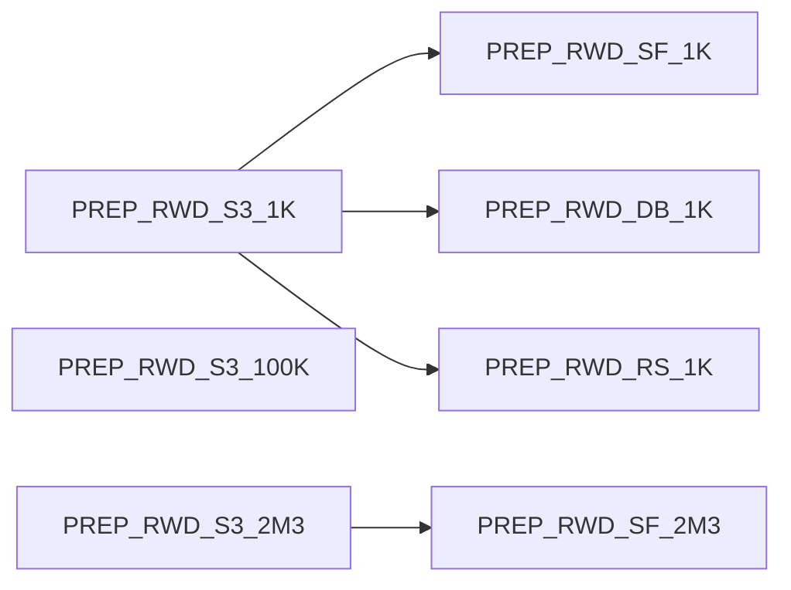

# RWD Cohort Discovery — Migration & Revision Plan

Sep 23, 2026 · @Li-Heng Fu

> **Lifecycle:** Planning (active until phase 5 closes) · **Part:** all · **Audience:** asset owners and
> contributors executing the migration · **Authority:** per-project decisions, step order and gates ·
> **Update when:** a step completes, a gate changes or an open question is decided. Live state is in
> `.index/`, not here.

## Summary and target end state

The suite goes from 11 in-scope projects to 10. Three S3 canonical projects and four connection variants replace seven prep projects, and `DEMO_DB_RWD2` is retired once `DEMO_SF_RWE` no longer depends on it.

New project keys use the pattern `PREP_RWD_<storage>_<size>`.

| Current project | Decision | Target | Why |
| --- | --- | --- | --- |
| `SYNPUFOMOP1KDATAPREPRWDV11` | Rebuild | `PREP_RWD_S3_1K` + `PREP_RWD_SF_1K`, `PREP_RWD_DB_1K`, `PREP_RWD_RS_1K` | Reference workflow; all 15 tables pass on S3, RS and DB, but its Snowflake tables are unbuilt |
| `RWD1KDATAPREPDEMO` | Retire after rebuild | — | Same 1K data, S3 only; superseded by `PREP_RWD_S3_1K` |
| `SYNPUFOMOP1KREDSHIFTDATAPREPARATION` | Retire | — | Ancestor of the RWDV11 project; superseded by `PREP_RWD_RS_1K` |
| `SYNPUFOMOP100KDATAPREPARATION` | Rebuild | `PREP_RWD_S3_100K` | Its Snowflake set passes but is unbuilt; its Redshift set is incomplete |
| `SYNPUFOMOP23DATAPREPARATION` | Rebuild | `PREP_RWD_S3_2M3` | Reference 2.3M download workflow; exports use the legacy `date` type |
| `DATABRICKSSYNPUFOMOP23DATAPREPERATION` | Retire | — | Legacy `date` type on 13 of 15 tables; no Databricks variant is needed at 2.3M |
| `DEMO_SF_OMOP2M_DATAPREP` | Replace | `PREP_RWD_SF_2M3` | Legacy `date` type on 13 of 15 mapped tables; its tables are unbuilt |
| `SOL_RWD_COHORT_DISCOVERY` | Keep, repoint | Reads `PREP_RWD_SF_1K` | Release reference |
| `DEMO_SF_RWD` | Upgrade v1.0 → v1.1 | Reads `PREP_RWD_SF_2M3` and gets the 45-script cohort library | Demo Part 2 |
| `DEMO_SF_RWE` | Keep, repoint | Reads 9 datasets from `DEMO_SF_RWD` | Demo Part 3 |
| `DEMO_DB_RWD2` | Retire (last) | — | Duplicate of the solution; its prep project is missing and its Snowflake tables are dropped |
| `TMP_RWD_SF_COLCASE_TEST` | Delete after review | — | Scratch project created for the column-case test in this review |

## Current-state audit

Audited on 2026-09-23 with the `dku` CLI and the solution's own schema rules (`CDM_SCHEMA`). Only 4 of the 7 prep projects hold a complete, compliant set on some storage, and the only compliant Snowflake data is not built.

| Project | Persons | Storage with a full 15-table set | v1.1 schema | Built? |
| --- | --- | --- | --- | --- |
| `SYNPUFOMOP1KDATAPREPRWDV11` | 1,000 | S3, Redshift, Databricks, Snowflake (`visit_occurrence_sf` on `bs-snowflake`, the rest on `managed-snowflake`) | Pass | S3 and RS yes; `managed-snowflake` tables do not exist; Databricks unreadable (per-user OAuth token expired) |
| `RWD1KDATAPREPDEMO` | 1,000 | S3 | Pass | Yes |
| `SYNPUFOMOP1KREDSHIFTDATAPREPARATION` | 1,000 | Redshift | Pass | Yes |
| `SYNPUFOMOP100KDATAPREPARATION` | 100K (per name) | Snowflake | Pass | `managed-snowflake` tables do not exist; `*_100k_db` on S3 has data |
| `SYNPUFOMOP23DATAPREPARATION` | 2,326,856 | S3 (`*_2_3_pc_db`) | **Fail**: legacy `date` | Yes |
| `DATABRICKSSYNPUFOMOP23DATAPREPERATION` | 2.3M | Databricks | **Fail**: legacy `date` | Yes |
| `DEMO_SF_OMOP2M_DATAPREP` | 2.3M | Snowflake | **Fail**: legacy `date` | Tables do not exist |

**Solution and demo projects**

- `SOL_RWD_COHORT_DISCOVERY`: v1.1 (`v1-1-1` @ `329ff1c`). It points at the RWDV11 `*_sf` tables, 14 of which are unbuilt, and its own datasets are reset to filesystem storage.
- `DEMO_SF_RWD`: v1.0 (library branch `revise-get-sql-table-path` @ `2000e29`, bs-commons `v2-3-0`). It reads the failing `DEMO_SF_OMOP2M_DATAPREP` tables.
- `DEMO_SF_RWE`: all 9 inputs are shared from `DEMO_DB_RWD2`, whose Snowflake tables no longer exist.
- `DEMO_DB_RWD2`: v1.1 code, identical recipes and wiki to the solution, plus 3 generated SQL recipes and a 45-script cohort library. `data_preparation_project_key` names `SNOWFLAKESYNPUFOMOP23DATAPREPERATION`, which does not exist; its `*_db` table names match the Databricks 2.3M project.

## Workstream A — Indexing and documentation system

Build the index first, because it becomes the checklist the other workstreams turn green. The design copies `demo-target-identification`: hand-written JSON registries, generated TSVs from `dku`, a committed snapshot, and `--check` in CI.

**Repo layout** (in this repo, `bs-rwe-assets`, the suite repo for the revision; solution code stays in `dataiku/bs-rwd-cohort-discovery`)

```
registry/projects.json        # hand-written: one entry per DSS project
.index/index_metadata.tsv     # path · owner · freshness · scope
.index/projects.tsv           # key, part, role, size, connection, library branch+hash, lifecycle
.index/datasets.tsv           # project, dataset, type, connection, built, row count
.index/schema_compliance.tsv  # project, omop_table, dataset, pass/fail, reason
.index/lineage.tsv            # consumer project, dataset, source project, source exists?
.index/dss_snapshot.json      # offline snapshot for CI
docs/README.md                # router: Part 1 / Part 2 / Part 3 / Decisions
docs/decisions/DECISION_REGISTER.md
docs/wiki/<PROJECT>/01-overview.md … 05-legal.md
tools/build_index.py          # --refresh (dku) | --check (offline)
tools/push_wiki.py            # drift report by default, --push to write
```

**Registry entry fields:** `key`, `part` (1/2/3), `role` (canonical, variant, release, demo), `sample_size`, `connection`, `upstream` (project keys), `owner`, `personas`, `library` (branch, pinned hash), `lifecycle` (active, retiring, archived), `wiki_version`.

**Steps**

1. Write `registry/projects.json` for the 11 current projects, with lifecycle set from the decision table above.
2. Write the schema checker into `tools/build_index.py` so `schema_compliance.tsv` is generated. It applies `CDM_SCHEMA` from the solution repo to every mapped OMOP table, as the 2026-09-23 audit did (the audit's ad-hoc scripts were not kept).
3. Add the lineage check: every shared-in dataset must exist in its source project. It would have caught `DEMO_SF_RWE` → `DEMO_DB_RWD2` and `DEMO_DB_RWD2` → the missing prep project.
4. Standardise the wiki on the demo suite set (Overview with the "Part n of 3" banner, Walkthrough, Technical Requirements, Release Notes, Legal). Add a licence banner to every Part 1 project.
5. Add a doc header (Lifecycle · Part · Audience/Persona · Authority · Update when) and the first decisions, `DEC-RWD-001` to `003` (uppercase normalisation, variant layout, 2.3M naming).
6. Wire `tools/build_index.py --check` into a pre-commit hook and GitHub Actions.

**Done when:** the index regenerates from DSS in one command, and CI fails on a missing project, a failing schema row, or a broken share.

**Status (2026-10-13): steps 1–6 built.** `registry/projects.json` covers the 12 projects above plus the 7 planned `PREP_RWD_*` keys; `tools/build_index.py --refresh` regenerates `.index/` from DSS; `--check` runs in CI and in `.githooks/pre-commit`. The 13 open problems are baselined in `registry/known_issues.json`, each with the step that clears it; the baseline only shrinks. Decisions recorded: `DEC-RWD-001` (uppercase normalisation), `002` (variant layout) and `003` (schema contract). The `2M3` naming did not meet the register's admission rule and stays in this plan. Differences from the 2026-09-23 audit:

- `SOL_RWD_COHORT_DISCOVERY` is not wired to `SYNPUFOMOP1KDATAPREPRWDV11` as the code sees it: its `local` variables, which the solution code reads, name the non-existent `SNOWFLAKESYNPUFOMOP23DATAPREPERATION`.
- `DEMO_SF_RWD`'s `local` scope overrides 5 table variables (`location`, `drug_era`, `condition_era`, `concept`, `concept_ancestor`) with names that do not exist in its prep project.
- The compliant concept table in `SYNPUFOMOP1KREDSHIFTDATAPREPARATION` is `concept_db`; `concept` has string dates.
- With a refreshed credential, both Databricks sets are built (15/15). The 1K set passes v1.1; the 2.3M set fails on the legacy `date` type, as audited.
- `TMP_RWD_SF_COLCASE_TEST` no longer exists, so the Workstream C regression check has to be rebuilt from the test table below.

## Workstream B — Rebuild the data prep layer

Build three S3 canonical projects from the two reference workflows, gate them on the schema check, then generate the four database variants by sync only.



**B1. Canonical S3 projects**

| Project | Base workflow | Source | Main work |
| --- | --- | --- | --- |
| `PREP_RWD_S3_1K` | Duplicate `SYNPUFOMOP1KDATAPREPRWDV11`, keep the `input` and `OMP CDM` zones, drop the `SF` / `RS` / `DB` / `redshift` zones | Uploaded 1K files + Athena vocabularies on `hls-synth-patient` | Cast `concept` / `concept_ancestor` ids from string to int (`ATHENA_CONCEPT` is all string today) |
| `PREP_RWD_S3_100K` | Same 1K workflow, pointed at the 100K raw files | 100K raw files on `hls-synth-patient` (currently all string-typed) | Reuse the 1K prepare steps; add `concept_ancestor`, which the S3 set is missing |
| `PREP_RWD_S3_2M3` | Duplicate `SYNPUFOMOP23DATAPREPARATION` | lzo archives downloaded to a managed folder, CDM v5.2 | Replace the string-typed Python schemas with `dateonly` / `datetimenotz` / `int`; map v5.2 → v5.3 column differences; check id ranges for `bigint` |

Every canonical project exposes exactly the 15 tables with lowercase names `<omop_table>` and a zone named `OMOP CDM export`.

**B2. Schema gate.** Nothing downstream is built until `schema_compliance.tsv` shows 15/15 pass for the project. Record row counts per table in `datasets.tsv`.

**B3. Connection variants.** Each variant is a new project that shares in the 15 canonical tables and has 15 sync recipes and nothing else. Names follow `<omop_table>_<conn>`, for example `person_sf`.

- `PREP_RWD_SF_1K` and `PREP_RWD_SF_2M3`: pick one Snowflake connection. `bs-snowflake` is the one that works today; `managed-snowflake` has only unbuilt tables.
- `PREP_RWD_DB_1K`: use a service-account connection, not `bs-databricks-per-user`. The per-user OAuth token expiry made it unreadable during this audit.
- `PREP_RWD_RS_1K`: `redshift-solutions`.
- Keep variant columns lowercase. The solution's import step uppercases them (see Workstream C), so the variant layer stays a faithful copy of the canonical one.

**B4. Verify.** Row counts in each variant equal the canonical ones, and the solution's "Check OMOP CDM Schema" scenario passes against every variant.

## Workstream C — `sync_omop_datasets` column-case investigation

The uppercase step is still needed. DSS no longer uppercases Snowflake columns by default, and Atlas-style cohort SQL with unquoted names fails against lowercase columns. Keep the normalisation, fix three silent-failure bugs, and record it as `DEC-RWD-001`.

**Test setup.** Scratch project `TMP_RWD_SF_COLCASE_TEST`, run 2026-09-23. A 3-row CSV with lowercase columns (`person_id`, `gender_concept_id`, `birth_date`) was written to Snowflake two ways: by a sync recipe (case kept) and by a prepare recipe with a ColumnRenamer to uppercase (what `sync_omop_datasets` does). Both were run on `bs-snowflake` and `managed-snowflake`.

| # | Table | Query style | Result |
| --- | --- | --- | --- |
| 0 | Sync from lowercase schema | `information_schema.columns` | Stored as quoted lowercase (`person_id`) on both connections. DSS does **not** uppercase by default |
| 1 | Lowercase | Unquoted, Atlas style: `select p.person_id …` | Fails: `invalid identifier 'P.PERSON_ID'` |
| 2 | Lowercase | Quoted: `p."person_id"` | Works (2 rows) |
| 3 | Uppercase | Unquoted, Atlas style | Works (2 rows) |
| 4 | Uppercase | Quoted lowercase: `p."person_id"` | Fails: invalid identifier |
| 6 | Lowercase | SQL script recipe, Atlas style (the solution's `create_cohort` path) | Job FAILED: `invalid identifier 'P.PERSON_ID'` |
| 7 | Lowercase | Same script, preceded by `ALTER SESSION SET QUOTED_IDENTIFIERS_IGNORE_CASE = TRUE` | Works (2 rows, output columns uppercase) |

**Why lowercase inputs would break the solution**

- The Atlas cohort scripts reference columns unquoted (for example `co.person_id` in `cohort_1`). Snowflake resolves those as `PERSON_ID` (tests 1 and 6).
- 36 of the 46 visual recipes in the solution hard-code uppercase names (77 references to `PERSON_ID`, 32 to `COHORT_DEFINITION_ID`, 25 to `SUBJECT_ID`).
- The `@cohort` init scripts create unquoted columns, so the cohort tables are uppercase anyway.

**Why not switch to `QUOTED_IDENTIFIERS_IGNORE_CASE`.** It works in test 7, but it makes every quoted identifier case-insensitive. `get_sql_path` quotes mixed-case table names such as `"SOL_RWD_COHORT_DISCOVERY_person"`, which would then resolve to an uppercase name that does not exist (reasoned from Snowflake's rules, not yet tested). Adopting it would mean renaming every dataset table, so it is a larger change than keeping the uppercase step.

**Code changes in `pipelines/sync_omop_datasets.py`** (the solution repo (`dataiku/bs-rwd-cohort-discovery`); line numbers refer to `v1-1-1` @ `329ff1c`)

1. Missing prep project fails silently (lines 141–144): it sets `has_errors = True` then `return`s without raising, so the scenario reports success. This is exactly `DEMO_DB_RWD2`'s state. Raise instead.
2. Rename only fires for all-lowercase names (line 39, `islower()`). A mixed-case column such as `Person_Id` is uppercased in the declared schema but never renamed. Rename whenever `name != name.upper()`.
3. Builds are fire-and-forget (line 191, `run(wait=False)` for all but the last recipe). Failures in those builds are never seen, and later steps can start early. Wait on every job, or build all outputs in one job.
4. `bigint` → `int` and `double` → `float` (lines 43–46) can overflow large ids at 2.3M. Keep `bigint`, and relax `_normalize_data_type` in `check_schema.py` to match.
5. `main_connection` is read from `variables['standard']` (line 129) while every other module reads `variables['local']`. Align them.
6. Document the uppercase contract in the function docstring and in the wiki's Data Model article.

**Regression test.** Keep `TMP_RWD_SF_COLCASE_TEST` until the fix lands, then turn tests 1, 3 and 6 into an index check and delete the project.

## Workstream D — Demo suite upgrade and retirements

Upgrade `DEMO_SF_RWD` to v1.1 and move the cohort library into it, repoint `DEMO_SF_RWE`, and only then drop `DEMO_DB_RWD2` and the superseded prep projects.

**D1. Upgrade `DEMO_SF_RWD` to v1.1**

1. Export a bundle of `DEMO_SF_RWD` as a rollback point.
2. Switch the library Git references: `python/solution` from `revise-get-sql-table-path` to `v1-1-1`, and `python/ds_common` from `v2-3-0` to `v2-3-1`.
3. Diff its recipes and scenarios against `SOL_RWD_COHORT_DISCOVERY` and bring the 46 v1.1 recipe definitions across. `DEMO_DB_RWD2` shows a clean v1.1 copy differs from the solution only in connections, run-as user and generated recipes.
4. Set `data_preparation_project_key = PREP_RWD_SF_2M3`, the 15 table variables, and `main_connection`. Run "Import Datasets from DataPrep Project" (it runs the schema check first).
5. Copy the 45 original scripts (folder `PqOBn6B3`) and the cohort metadata from `DEMO_DB_RWD2`. Run "Create Cohort Scripts" then "Write Cohort to Datasets".
6. Check `cohort_building_log` against the counts `DEMO_DB_RWD2` recorded on 2025-10-06, for example heart failure 188,113, stroke 57,077, AMI 30,784. Only the cached preview sample survives, so export it before retiring the project.
7. Update the wiki to Version 1.1.0 and the Release Notes.

**D2. Repoint `DEMO_SF_RWE`**

1. Share the 9 datasets from `DEMO_SF_RWD` and swap each recipe input from `DEMO_DB_RWD2.<name>` to `DEMO_SF_RWD.<name>`.
2. Fix the walkthrough article: it lists `drug_exposure_grouped`, but the flow reads `drug_class_exposure`.
3. Rebuild and check the survival analysis dashboard renders.

**D3. Retire, in this order**

| Order | Project | Precondition | Before deleting |
| --- | --- | --- | --- |
| 1 | `DEMO_DB_RWD2` | D2 done; `DEMO_SF_RWE` has no shares from it | Bundle export; save the cohort library and the log sample |
| 2 | `DEMO_SF_OMOP2M_DATAPREP` | `DEMO_SF_RWD` reads `PREP_RWD_SF_2M3` | Bundle export (licence-restricted: keep it internal) |
| 3 | `DATABRICKSSYNPUFOMOP23DATAPREPERATION` | No consumers | Bundle export |
| 4 | `SYNPUFOMOP1KREDSHIFTDATAPREPARATION`, `RWD1KDATAPREPDEMO` | `PREP_RWD_S3_1K` and `PREP_RWD_RS_1K` pass B4 | Bundle export |
| 5 | `SYNPUFOMOP1KDATAPREPRWDV11`, `SYNPUFOMOP100KDATAPREPARATION`, `SYNPUFOMOP23DATAPREPARATION` | The solution and demo read only from `PREP_RWD_*` | Bundle export; keep the 2.3M lzo folder until `PREP_RWD_S3_2M3` is verified |
| 6 | `TMP_RWD_SF_COLCASE_TEST` | Workstream C fix merged | None |

The project owner deletes each project; deletion also drops the managed data, so each bundle is the only way back. The lineage index must show zero broken shares after every step.

## Sequencing, gates and risks

Run the work in five phases. Each phase ends at a gate the index can check, and nothing is deleted before phase 5.

| Phase | Work | Gate to exit |
| --- | --- | --- |
| 1. Index | Workstream A steps 1–3 | Registry covers 11 projects; compliance and lineage TSVs reproduce this audit |
| 2. Fix | Workstream C code changes, released as a patch on a new library branch | Tests 1, 3 and 6 behave as documented; missing prep project now fails the scenario |
| 3. Data | Workstream B: canonical S3 projects, then 4 variants | 15/15 pass and row counts match on all 7 `PREP_RWD_*` projects |
| 4. Consumers | Repoint the solution to `PREP_RWD_SF_1K` and test it on DB and RS; D1 and D2 | 3 sample cohorts match across SF, DB and RS; 45 cohorts rebuilt on 2.3M; RWE dashboard renders |
| 5. Retire | D3 in order; Workstream A steps 4–6 | Zero broken shares; retired projects archived as bundles; CI green |

**Risks and mitigations**

| Risk | Mitigation |
| --- | --- |
| Dropping `DEMO_DB_RWD2` early breaks `DEMO_SF_RWE` | Retirement is gated on D2 and on the lineage check |
| CDM v5.2 → v5.3 differences in the 2.3M source | Map columns in `PREP_RWD_S3_2M3` and let the schema gate catch gaps |
| Id overflow at 2.3M after `bigint` → `int` | Code change C4; check max ids per table in B2 |
| Databricks per-user OAuth expiry blocks builds and checks | Service-account connection for `PREP_RWD_DB_1K` |
| Unclear Snowflake connection (`bs-snowflake` vs `managed-snowflake`) | Decide before phase 3 and record as a decision |
| SYNPUF licence: data must not leave internal instances | Licence banner on every Part 1 wiki; bundles stored internally only |

**Rollback.** Every mutated or retired project gets a bundle export first. The solution's library pin rolls back by switching the Git reference to `v1-1-1` @ `329ff1c`.

- [ ] Name an owner for each part
- [ ] Choose the Snowflake connection for the variants
- [ ] Confirm the variant layout (separate projects or zones) and the `2M3` naming
