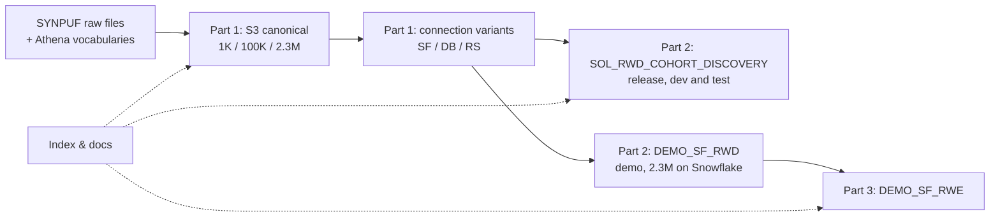

# RWD Cohort Discovery — Project Scoping

Sep 23, 2026 · @Li-Heng Fu

> **Lifecycle:** Canonical · **Part:** all · **Audience:** asset owners, account team, solution and RWE leads ·
> **Authority:** what the revision covers, why, and for whom · **Update when:** scope, personas,
> owners or success criteria change.

## Context and problem

The RWD/RWE assets on the design instance have drifted apart: the released solution is on v1.1, the Snowflake demo suite is on v1.0, and three of the seven SYNPUF OMOP data prep projects fail the v1.1 schema check.

- **Released solution.** `SOL_RWD_COHORT_DISCOVERY` runs v1.1 (library branch `v1-1-1`). It is wired to `SYNPUFOMOP1KDATAPREPRWDV11` and every mapped table passes the schema check. Its datasets are currently reset to local filesystem storage.
- **Snowflake demo suite (v1.0).** `DEMO_SF_OMOP2M_DATAPREP` → `DEMO_SF_RWD` → `DEMO_SF_RWE`. The prep project's exported tables store dates as the legacy DSS `date` type, so 13 of 15 mapped tables fail the v1.1 check. `DEMO_SF_RWE` has no solution variables set and lists 9 datasets that no longer exist.
- **Data prep sprawl.** Seven SYNPUF OMOP prep projects cover 1K, 100K and 2.3% samples across S3, Snowflake, Redshift and Databricks. They follow at least two different workflows, and several are copies of each other.
- **Duplicate solution.** `DEMO_DB_RWD2` is a copy of the solution with a 45-script cohort library. It points at a prep project that no longer exists, and its Snowflake tables have been dropped.
- **No index.** Nothing on the instance says which project is canonical, who owns it, or which persona it serves.

## Scope overview

The revision keeps the three-part structure the Snowflake demo suite wiki already uses ("RWD/RWE Solution Demo Assets"), rebuilds each part on v1.1, and adds one index across all of them.

| Part | What it delivers | DSS projects (target) | Primary personas |
| --- | --- | --- | --- |
| 1. OMOP Data Foundation | Harmonised SYNPUF OMOP CDM input tables that pass the v1.1 schema check, in three sample sizes and four storage variants | 3 S3 canonical projects (1K, 100K, 2.3M) + 3 connection variants (1K Snowflake / Databricks / Redshift) + 1 full copy for the demo suite (2.3M Snowflake, `DEMO_SF_PREP_OMOP_2M3`) | Solution developer, QA / test engineer, demo installer |
| 2. RWD Cohort Discovery | The released solution: cohort repository, clinical covariates, cohort features, cohort dashboard | `SOL_RWD_COHORT_DISCOVERY` (release) + `DEMO_SF_RWD` (demo, upgraded to v1.1) | Biomedical informaticist, clinical researcher |
| 3. Real World Evidence | A worked RWE study (LEGEND-HTN replication: ACEi first-line survival analysis) built on Part 2 outputs | `DEMO_SF_RWE` | Epidemiologist / HEOR researcher, account team |
| Cross-cutting: Index & docs | One registry of every RWD/RWE project, generated lineage and schema indexes, standard wiki and doc headers | `bs-rwe-assets` repo + DSS wiki | All of the above, plus the asset owner |

Data flows left to right. Each part consumes the part before it only through shared datasets; nothing downstream reads the raw files.

**In scope:** the 7 SYNPUF OMOP prep projects, the solution, the Snowflake demo suite, `DEMO_DB_RWD2` (retirement), and the column-case behaviour of `sync_omop_datasets`.

**Out of scope:** `SYNTHEA1KOMOP`, `SYNPUF` (workshop), `COHORTICULTURE`, new solution features, publishing to the Business Solutions Store, and deploying the demo suite to the automation node (it needs someone with authority to deploy there).

## Part 1 — OMOP Data Foundation

Part 1 replaces seven overlapping prep projects with three canonical S3 projects, three thin connection variants and one full copy for the demo suite, all passing the v1.1 schema check.

**Scope**

- **Canonical layer (S3, `dataiku-managed-storage`).** One project per sample size: 1K, 100K and 2.3M persons. Each one ingests raw SYNPUF OMOP files plus Athena vocabularies, then normalises and harmonises them into the 15 OMOP tables the solution reads (13 standard + `concept`, `concept_ancestor`).
- **Workflow reuse.** The 1K and 100K projects follow the `SYNPUFOMOP1KDATAPREPRWDV11` pattern: uploaded or S3 files → prepare → S3. The 2.3M project follows `SYNPUFOMOP23DATAPREPARATION`: download lzo archives → Python decompress per part → stack → prepare → S3.
- **Harmonisation contract.** Column names lowercase and types matching `CDM_SCHEMA` in `schema/cdm_schema.py` of the solution repo (`dataiku/bs-rwd-cohort-discovery`). In particular: `dateonly` for OMOP DATE, `datetimenotz` for DATETIME, `int` for ids and concept ids. No legacy `date` type anywhere.
- **Database projects.** The 1K connection variants are sync-only projects that share in the canonical S3 tables and write them to one database (DEC-RWD-002). The demo suite's 2.3M Snowflake set is the exception: a full copy of the 2.3M canonical project that reads no other project, so the demo suite can be bundled or rebuilt without its canonical project ([DEC-RWD-004](decisions/DECISION_REGISTER.md#dec-rwd-004--the-demo-suites-23m-prep-project-is-a-full-copy-of-prep_rwd_s3_2m3)):

| Project | Source | Target connection | Purpose |
| --- | --- | --- | --- |
| 1K Snowflake variant | 1K S3 (shared, synced) | Snowflake | Solution development and CI-style regression |
| 1K Databricks variant | 1K S3 (shared, synced) | Databricks | Dialect test for the Databricks SQL templates |
| 1K Redshift variant | 1K S3 (shared, synced) | `redshift-solutions` | Dialect test for the Redshift SQL templates |
| `DEMO_SF_PREP_OMOP_2M3` | 2.3M S3 (full copy) | Snowflake | Demo suite input and performance testing |

**Business value**

- Cuts demo and test setup from a manual, multi-day data-prep exercise (see the installation manual's step 2) to repointing one project variable.
- One schema contract means a failed solution run is a solution bug, not a data bug. Today 3 of 7 prep projects fail the v1.1 check.
- Three sizes let the team test behaviour (1K, seconds), scale (100K) and realistic demo volumes (2.3M) on the same code path.

**Personas served**

- *Solution developer:* needs a fast, trustworthy 1K input on every supported connection.
- *QA / test engineer:* needs the same data on SF, DB and RS to compare outputs across dialects.
- *Demo installer (account team):* needs a ready 2.3M Snowflake input and must not redistribute it (SYNPUF licence restriction in the manual).

**Owner:** Data foundation owner (to be named). They are accountable for the schema contract and for rebuilding the variants when the canonical layer changes, and for applying 2.3M canonical changes to `DEMO_SF_PREP_OMOP_2M3`.

One naming fix belongs here: the `_2_3_pc` / "2.3%" projects actually hold 2,326,856 persons, i.e. the full \~2.3M DE-SynPUF, and `DEMO_SF_OMOP2M_DATAPREP` calls the same data "2M".

## Part 2 — RWD Cohort Discovery

Part 2 is the released v1.1 solution plus one v1.1 demo instance on Snowflake; the revision changes its inputs, its import function, its Project Setup and the repository its code lives in, not its features.

**Scope**

- `SOL_RWD_COHORT_DISCOVERY` stays the release reference. Its code moves into this repo and its Project Setup errors are fixed. It is tested against every SQL `PREP_RWD_*` variant (1K Snowflake, Databricks and Redshift) before each release, and stays on the 1K Snowflake variant for development.
- `DEMO_SF_RWD` (v1.0 today, library branch `revise-get-sql-table-path`) is recreated as a copy of the latest released solution, configured through Project Setup to read `DEMO_SF_PREP_OMOP_2M3`. Its work starts only after the solution revision.
- The 45-script cohort library now in `DEMO_DB_RWD2` (hypertension treatments, CV outcomes, 36 condition and drug features) moves into `DEMO_SF_RWD`, because Part 3 needs those cohorts.
- `sync_omop_datasets` keeps its uppercase column normalisation (the test shows it is still required) but gets its silent-failure bugs fixed. Details are in the migration plan.

**Business value**

- Turns Atlas cohort SQL into a governed, reusable cohort repository (`cohort`, `cohort_definition`), so phenotypes are validated once and reused across studies.
- Gives clinical stakeholders a no-code dashboard (incidence, prevalence, demographics, Charlson score, condition, drug and visit covariates) to validate a cohort before any study starts.
- A v1.1 demo on 2.3M persons shows realistic cohort sizes, e.g. 188,113 patients with an inpatient heart-failure event in the last `DEMO_DB_RWD2` build.

**Personas served** (from the solution wiki's "key beneficiaries")

- *Biomedical informaticist:* ingests Atlas scripts and cohort metadata, runs the cohort pipeline, owns phenotype quality.
- *Clinical researcher:* reviews and validates cohorts in the dashboard.
- *Epidemiologist / HEOR researcher:* consumes the cohort repository and covariates downstream (Part 3).

**Owner:** Solution owner (to be named). They are accountable for the solution code in the solution repo (`dataiku/bs-rwd-cohort-discovery`), the library branch pinned in each project, and release testing on all three dialects.

## Part 3 — Real World Evidence

Part 3 keeps the existing RWE study unchanged in method but rewires its inputs from `DEMO_DB_RWD2` to the upgraded `DEMO_SF_RWD`.

**Scope**

- `DEMO_SF_RWE` replicates part of the LEGEND-HTN study: the treatment effect of first-line ACE-inhibitor monotherapy versus untreated hypertension on cardiovascular outcomes. It uses propensity-score-adjusted Cox survival analysis with visual ML and Python recipes.
- It imports 9 datasets from Part 2: `cohort`, `cohort_definition`, `concept`, `concept_ancestor`, `visit_occurrence_labeled`, `person_location_joined`, `drug_class_exposure`, `condition_group_occurrence`, `charlson_score_occurrence`.
- All 9 are currently shared from `DEMO_DB_RWD2`, whose Snowflake tables no longer exist. Repointing them to `DEMO_SF_RWD` is the only structural change.
- The code environment (`lifelines==0.27.8`, `scikit-survival==0.22.1`) and the 12 flow zones stay as they are.

**Business value**

- Shows the end-to-end story the RWD solution is sold on: reusable cohorts and covariates cut the time from question to evidence, instead of every study rebuilding phenotypes in notebooks.
- Gives the account team a credible, published-methodology study to demo with, not a toy example.

**Personas served**

- *Epidemiologist / HEOR researcher:* defines treatment, control, outcome and feature cohorts, runs the survival model.
- *Biostatistician:* reviews the propensity model and Cox results.
- *Account team / solutions engineer:* demos the full RWD → RWE path to customers (internal instances only).

**Owner:** RWE demo owner (to be named). They are accountable for the study logic, the code environment, and keeping the 9 input datasets aligned with Part 2 dataset names.

## Cross-cutting — Project index and documentation system

The index follows the `demo-target-identification` model: small hand-written registries for facts DSS cannot supply, generated TSV indexes for everything it can, and a `--check` mode run in CI.

**What we adopt, adapted to a multi-project suite**

| Element | In `demo-target-identification` | For the RWD/RWE suite |
| --- | --- | --- |
| Hand-written registry | `tools/index_manifest.json`, `model_registry.json` | `registry/projects.json`: one entry per DSS project with part, role (canonical / variant / release / demo), sample size, connection, owner, personas, library branch, lifecycle (active / retiring / archived) |
| Generated indexes | `.index/*.tsv` built from `dku` | `.index/projects.tsv`, `datasets.tsv` (name, connection, row count, built?), `schema_compliance.tsv` (per OMOP table vs `CDM_SCHEMA`), `lineage.tsv` (cross-project shares) |
| Offline snapshot | `.index/dss_snapshot.json` | Same, so CI runs without DSS access |
| Index of indexes | `.index/index_metadata.tsv` (path, owner, freshness, scope) | Same |
| Doc header | Lifecycle · Audience · Authority · Update when | Same, plus **Part** and **Persona** |
| Decision register | `DECISION_REGISTER.md`, stable ids | `DEC-RWD-###` for choices such as "keep uppercase normalisation" |
| Wiki drafts | Numbered articles, published by hand | Same numbered set per project (Overview, Walkthrough, Technical Requirements, Release Notes, Legal), plus a push script (the reference repo has none) |

**Business value:** anyone can answer "which project is canonical, is it built, does it pass v1.1, who owns it" from one file. The failures found in this review would have shown up as red rows: unbuilt Snowflake tables, a missing prep project, and dropped tables still shared into `DEMO_SF_RWE`.

**Personas served:** the asset owners of each part, new team members onboarding, and coding agents working in `bs-rwe-assets` (`CLAUDE.md` / `AGENTS.md` generated from one source).

**Owner:** Suite owner (to be named). They are accountable for the registry being complete and the CI check staying green.

## Ownership, success criteria and open questions

Every part has one accountable owner role; names are still to be assigned.

| Activity | Data foundation owner | Solution owner | RWE demo owner | Suite owner |
| --- | --- | --- | --- | --- |
| Canonical S3 projects and schema contract | A / R | C | I | I |
| Connection variants (SF, DB, RS) and the demo copy | A / R | C | I | I |
| `sync_omop_datasets` fix and release testing | C | A / R | I | I |
| `DEMO_SF_RWD` recreation and cohort library | C | A / R | C | I |
| `DEMO_SF_RWE` repointing | I | C | A / R | I |
| Registry, indexes, CI check, wiki standard | C | C | C | A / R |
| Retiring old projects (incl. `DEMO_DB_RWD2`) | R | R | C | A |

A = accountable, R = responsible, C = consulted, I = informed.

**Success criteria**

- All 7 target prep projects pass the v1.1 schema check on all 15 mapped tables, and every export table is built (non-zero row count).
- `SOL_RWD_COHORT_DISCOVERY` builds the 3 sample cohorts end to end on the 1K SF, DB and RS variants with identical cohort counts.
- `DEMO_SF_RWD` (v1.1) rebuilds the 45-cohort library on 2.3M persons, and `DEMO_SF_RWE` runs its survival analysis on those outputs.
- `registry/projects.json` lists every in-scope project, and the index `--check` passes in CI.
- Retired projects are gone from the instance with no broken shares left behind.

**Risks**

- `DEMO_SF_RWE` depends on `DEMO_DB_RWD2` today. Dropping it before the repoint leaves Part 3 with no inputs.
- The 2.3M source is OMOP CDM v5.2 lzo files (e.g. `death.5.2.csv.lzo`), while the solution checks v5.3 columns. Some columns need mapping.
- ~~Id columns are normalised to `int` on import. 2.3M-row fact tables may hold ids above 2,147,483,647, which would need `bigint`.~~ Ruled out 2026-10-15: the largest 2.3M id is 289,182,385.
- Snowflake connections: most `managed-snowflake` export tables are unbuilt, and `bs-snowflake` is the one that currently works. Which one hosts the variants must be decided.

**Open questions**

- Who owns each part?
- Rename the "2.3%" projects to "2.3M"?
- ~~Connection variants as separate projects or as zones in one project?~~ Decided: separate sync-only projects (DEC-RWD-002); the demo suite's 2.3M Snowflake set is a full copy (DEC-RWD-004, 2026-10-16).
- Is 100K needed on any database, or is S3-only enough?
